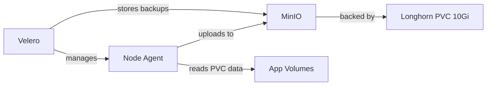
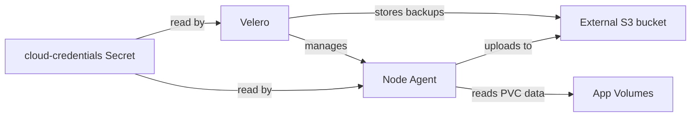

# Backup & Restore

Kipper includes automatic backup and restore powered by [Velero](https://velero.io). The default daily schedule backs up user resources and persistent volume data, with the namespace exclusions described below.

There are two storage modes:

- **In-cluster MinIO (the default on Longhorn clusters).** Zero configuration, no external account required. Backups live on Longhorn-backed storage on the same host as the cluster.
- **External S3-compatible storage** (AWS S3, Cloudflare R2, self-hosted MinIO, B2, Wasabi, Spaces). Backups live off-cluster and survive a `kip cluster uninstall` or a host failure.

For any cluster that holds data you cannot afford to lose, configure external storage at install time. See [External backup storage](/en/installation#external-backup-storage) on the installation page for the flags.

A cluster with [local storage](/en/nano) runs Velero only after you configure external storage, because a backup on the same disk would be lost if the disk failed. Until then, `kip backup` and the console's Backups page explain that backups are not configured, and `kip node reboot` reboots without its usual backup. To add external storage later, run `kip install` again with `--backup-storage-bucket` and its related flags. Read [Re-running install](/en/installation#re-running-install) first, because a re-run resets users created in the console.

## Automatic backups

A daily backup runs at 3:00 AM and is retained for 7 days. This is configured during `kip install` and runs automatically.

```bash
kip backup schedules
```

```
  NAME                      SCHEDULE        STATUS       LAST BACKUP
  velero-daily-apps         0 3 * * *       Enabled      2026-03-18T03:00:00Z
  velero-weekly-system      0 4 * * 0       Enabled      2026-03-15T04:00:00Z
```

## Manual backups

### Back up everything (user namespaces)

```bash
kip backup create
```

This skips the system namespaces (`kube-system`, `kube-public`, `kube-node-lease`, `traefik`, `longhorn-system`, `keda`, `monitoring`, `velero`) and the restore drill's namespace (`kipper-restore-drill`), and captures everything else. The daily schedule uses the same exclusion. Excluding `velero` prevents the backup from capturing the MinIO volume that stores its own output.

### Back up the system namespaces too

```bash
kip backup create everything --include-system
```

Use this when your recovery plan requires system resources. It also captures every cluster-wide object, such as ClusterIssuers and ClusterRoles. Review the storage warning above before including Velero’s own namespace.

Even here, cert-manager's transient issuance objects (CertificateRequests, Orders, Challenges) stay out of the backup. cert-manager recreates them on demand; restoring stale issuance state can interfere with renewal.

### Back up a specific project

```bash
kip backup create --project blog --environment test
```

### Back up with a custom name

```bash
kip backup create pre-migration --project blog
```

### List backups

```bash
kip backup list
```

```
  NAME                                STATUS       NAMESPACES           CREATED           DUMPS
  velero-daily-apps-20260318030000    Completed    all except system    2026-03-18 03:00  complete (2)
  pre-migration                       Completed    blog-test            2026-03-18 14:30  complete (1)
  manual-20260318-153000              Completed    all except system    2026-03-18 15:30  -
```

`all except system` means the system-namespace exclusion was applied. `all` means `--include-system` was passed, so no namespace was skipped. A namespace name means the backup was scoped via `--project`. DUMPS reports the status of [consistent database dumps](#consistent-database-dumps) and counts their volumes: `pending` while the backup runs, `complete (n)` when the backup completed, all recorded dump volumes were copied, and hook attempts were recorded without failures. `failed` means the backup, a hook or a volume copy failed, or hook attempts are missing. `-` means validation failed or a completed backup has no dump records or hook failures. `unknown` means a failed backup has neither dump records nor hook failures, or kip cannot read the volume copy records.

### Consistent database dumps {#consistent-database-dumps}

A volume backup copies a running database's files, so restoring it requires crash recovery. New Postgres services therefore also put a `pg_dump` of every database into each backup. Before Velero copies the service's volumes, a hook in the Postgres container dumps each database from one snapshot, counts every table's rows in that same snapshot, and dumps the roles. The dumps go to a separate dump volume of the same size as the data volume, which the backup copies along with the data, and a hook removes them once the copy is done. A manifest next to the dumps lists each database with its dump's size, SHA-256 checksum and `pg_dump` exit code, and ends with `complete true` when all dump and row-count sessions succeed.

If a dump fails, Velero continues with the volume backup, records the hook failure, and `kip backup list` shows `failed` for that backup. The hook refuses to start unless the dump volume has room for the data directory excluding the write-ahead log. Insufficient free space on the dump volume can show `failed` even for a healthy database. Increasing the service's storage expands both volumes when the storage class supports expansion. Where the dump volume shares a disk with the database, as local volumes do, it also keeps the larger of 2 GiB and a tenth of that disk free. A database whose name contains a line break or a tab makes the dump fail, because the manifest cannot record it.

Enable or disable consistent dumps for an existing service. Changing the setting restarts the database once:

```bash
kip service update mydb --consistent-backups
kip service update mydb --consistent-backups=false
kip service add postgres --name mydb --consistent-backups=false   # Create a service with consistent dumps disabled.
```

For a Postgres service declared in `kipper.yaml`, set `consistentBackups: true` to enable consistent dumps. Omitting this field from the service's manifest entry disables consistent dumps when the manifest is applied. If the field is currently set, `kip apply` lists it as a field to be cleared and requires `--force` to proceed. Each database uses a consistent snapshot. Databases are dumped sequentially, so their snapshots represent different points in time. Each service stores its current set of dumps on its own dump volume and removes the previous set before starting a new one.

## Restoring from a backup

### Restore to the same namespace

```bash
kip backup restore pre-migration
```

### Restore to a different namespace

Useful for testing a restore without affecting the live environment:

```bash
kip backup restore pre-migration --namespace-mapping blog-test:blog-restored
```

This restores only `blog-test` into `blog-restored`. If you also pass `--namespace`, it must match the source namespace (`blog-test`).

The copy excludes the source's Ingresses because they would claim the live app's hostnames. It also excludes cert-manager Certificates because they would keep renewing certificates for those hostnames. Pass `--include-ingresses` to restore both. The copy's Secrets and connection settings retain references to the source environment's services, so check them before allowing the copy to connect.

### Test a restore with a drill

A drill tests whether services from the latest completed backup can be restored in a separate namespace while keeping the live environment running:

```bash
kip backup drill blog-prod
```

It restores the database and other service pods of `blog-prod`, with their volumes and credentials, into `kipper-restore-drill` from the latest completed backup that covers `blog-prod`. App pods, Deployments, Jobs, CronJobs and Ingresses are excluded to avoid starting applications that could connect to the live database or claim live hostnames. Before restoring anything, kip creates a NetworkPolicy that allows traffic between drill pods and outgoing queries to the cluster's DNS. Enforcement requires a NetworkPolicy controller. k3s runs one unless started with `--disable-network-policy`. Kubernetes still allows traffic between a pod and its node.

kip then checks that every PVC-backed volume of the restored services has a completed volume restore, waits for each service to become ready, and counts rows in its user tables with `count(*)`. For Postgres, it checks all connectable, non-template databases and includes the database and schema in each table name. For MySQL, it checks tables outside the system schemas and includes the database in each table name. Direct counts remain useful after crash recovery resets Postgres statistics during startup of a restored volume. Other service types are reported as restored without a row check.

When a restored Postgres service carries a consistent dump, kip also tests the logical restore. It checks that the manifest marks the dump as complete and that each dump matches its recorded SHA-256 checksum. It then restores each database's dump into a scratch database inside the drill namespace and compares the exact per-table row counts with the counts recorded from the dump's snapshot. A dump that is incomplete, altered or restores with different counts fails the drill. Restoring the dumps requires free space on the restored data volume for a second copy of each database.

Finally, kip prints the backup's name and completion time and requests deletion of the drill namespace unless `--keep` is set.

| Flag | Default | Description |
|---|---|---|
| `--backup` | the latest completed backup that covers the namespace | Backup to restore |
| `--keep` | `false` | Keep the drill namespace for inspection |
| `--clean` | `false` | Only delete a drill namespace left by `--keep` or an interrupted drill, after waiting for any drill restore still running |

Record each drill's date and result with your compliance records because kip does not retain them. The drill namespace is excluded from the schedules and from `kip backup create` by default. A backup made with `--include-system` can include a retained drill.

If you interrupt a drill without `--keep`, kip requests deletion of the drill namespace if its restore has already finished or is absent. If the restore is still running or its state cannot be checked, kip leaves the namespace and tells you to run `kip backup drill <namespace> --clean` later.

### Restore a Postgres dump into a new service

A volume restore brings a database back as it was on disk. To recover a database from its consistent dump, restore the dump into a new, empty Postgres service in the same namespace:

```bash
kip service add postgres --name mydb-restored
kip service restore-dump mydb --to mydb-restored
```

kip restores the namespace's service pods, including the backup's copy of `mydb`, into the isolated drill namespace, as it does for a drill. It checks the dump manifest and every dump's SHA-256 checksum before writing to the target. Each database is then streamed through the Kubernetes API into `mydb-restored` in one transaction, so a dump that fails to load or arrives truncated leaves that database empty. If the connection to the target drops during a load, kip cannot tell whether that transaction committed and says so. Afterwards the per-table row counts must match the counts recorded with the dump. Resource tuning is paused for the target during the restore. At the end, kip requests deletion of the drill namespace if the Velero restore has finished or is absent. If the restore is still running or its state cannot be checked, kip leaves the namespace and prints cleanup instructions. If a restore fails partway through, delete and recreate the target before trying again because databases restored before the failure remain in it.

The target must have no user tables in any connectable, non-template database. This check protects existing table data from being overwritten. Roles and grants are not restored. Every restored object belongs to the target's own user, which is also the user its bindings connect as, so apps can access the restored data once you bind them with `kip service bind mydb-restored <app>`. Use `--backup` to choose a specific backup instead of the default, the latest completed backup covering the namespace. `--project` and `--environment` select the namespace. Drills and dump restores share the drill namespace, so only one can run at a time.

### Restore projects

Backups also include Kipper's cluster-wide objects: projects, their resource adjustments, the platform configuration and the cluster identity. Restores exclude these by default. To restore projects and their resource adjustments, run:

```bash
kip backup restore pre-migration --cluster-resources
```

`--cluster-resources` restores projects and their resource adjustments. By default, Velero skips existing objects, preserving live project settings. This flag cannot be combined with `--namespace-mapping`. The platform configuration and cluster identity are always excluded from restores because each cluster creates its own during installation.

### Restore progress and credentials

`kip backup restore` waits up to four hours for Velero to finish and reports phase changes as it polls. Press Ctrl-C to stop waiting; the restore continues in the cluster.

After a `Completed` or `PartiallyFailed` restore, kip checks restored service credentials Secrets. Those with no live owner need to be re-attached to their matching service. On a terminal, kip lists the affected services and asks for confirmation. Confirm only if nobody else could write Secrets in those projects during the restore, since repair relies on labels that those writers could also set.

After the credentials check, a `PartiallyFailed` restore returns an error, even if credential repair succeeds.

For an unattended restore, pass `--repair-credentials` under the same condition. If you decline, or run without a terminal and omit the flag, kip shows how to repair the credentials later with `kip service credentials --repair`.

### Partially failed backups

`kip backup restore` requires `--allow-partial` to restore a backup marked `PartiallyFailed`, because restored data or resources may be incomplete. Choose a `Completed` backup when possible. If you proceed with `--allow-partial`, kip warns about missing data and lists volumes with failed or canceled backups when those details are available.

### CPU and memory after a restore

A restore recovers resource settings and their field ownership. User-set CPU and memory values therefore remain user settings. If ownership cannot be restored for an App value, Kipper holds it unchanged until you confirm it or enable automatic sizing. See [Values Kipper cannot attribute](/en/resource-management#held-values).

Resource tuning records are excluded from backups. After a restore, Kipper creates new records from the current workload allocation, collects fresh usage readings and starts without the previous OOM cooldown or pending recommendation.

## What gets backed up

| Resource | Backed up? | How |
|---|---|---|
| Deployments, Services, Ingresses | Yes | Kubernetes resource definitions |
| ConfigMaps, Secrets | Yes | Kubernetes resource definitions |
| Environment variables and app secrets | Yes | Workload specs and Kubernetes Secrets |
| PostgreSQL data | Yes | PVC data via Kopia file-system backup |
| Redis data | Yes | PVC data via Kopia file-system backup |
| Longhorn volumes | Yes | Full file-system backup of volume contents |
| Projects and resource adjustments | Yes | Restored only with `--cluster-resources` |
| Platform configuration and cluster identity | Yes | Included in backups and always excluded from restores |
| Resource tuning records | No | The auto-sizer rebuilds them from the running workloads |

## Architecture

### In-cluster MinIO (default)



- **Velero** orchestrates backups and restores
- **Node Agent** (DaemonSet) reads actual file data from persistent volumes using Kopia
- **MinIO** provides S3-compatible storage inside the cluster
- **Longhorn** provides durable storage for MinIO itself

### External S3-compatible storage



- **External bucket** lives in AWS S3, Cloudflare R2, self-hosted MinIO, B2, Wasabi, DigitalOcean Spaces, or any other S3-compatible service
- **cloud-credentials Secret** in the `velero` namespace holds the access key, written from the credentials file you passed at install time
- The Velero HelmChart references the Secret by name; the credentials never appear in any HelmChart CR or kubectl-apply output
- Local `~/.kip/config.yaml` records mode + bucket + region + endpoint, never the keys
- With `--backup-storage-sse-c`, the store encrypts Velero's own objects with a key in the `kipper-backup-sse-key` Secret, and volume data stays encrypted by the backup repository key. See [SSE-C](/en/installation#backup-sse-c)

To rotate keys later, run `kip install` again with the updated credentials file pointing at the same host. That replaces the Secret in place. Note it re-runs the rest of the install too, which is not free: see [what an upgrade moves](/en/maintenance#what-an-upgrade-moves-and-what-it-does-not).

## Retention

Default retention is 7 days (`168h`). To create a backup with custom retention:

```bash
kip backup create --ttl 720h  # 30 days
```

## Limitations

- **In-cluster mode**: backups are stored inside the cluster, so a host loss or `kip cluster uninstall` takes the backups with it. Configure [external backup storage](#external-s3-compatible-storage) for clusters that hold data you care about.
- Database volumes are copied while the database runs. Postgres services with [consistent backups](#consistent-database-dumps) also include a `pg_dump` per database. MySQL and MongoDB include only the volume copy, so use their native tools alongside Velero when you need a logical dump.
- Backup storage mode is chosen at install time, and there is no command that migrates a running cluster from one mode to another. **Do not uninstall in order to switch.** In in-cluster mode the backups live on the cluster, so `kip cluster uninstall` removes them along with everything else, and a backup taken just beforehand is gone before you can restore it. Re-running `kip install` with `--backup-storage-bucket` does repoint Velero at external storage, but it leaves your existing backups behind and re-runs the rest of the install, so it is a deliberate change rather than a migration. The route that keeps your data is to install a second cluster with external storage and move workloads onto it. See [One-shot decision](/en/installation#one-shot-decision).
