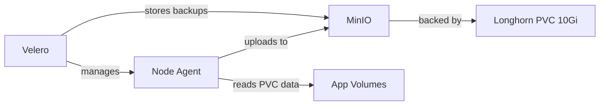
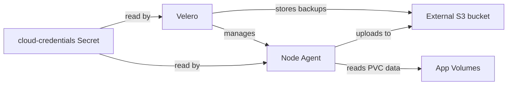

# Backup & Restore

Kipper includes automatic backup and restore powered by [Velero](https://velero.io). The default daily schedule backs up user resources and persistent volume data, with the namespace exclusions described below.

There are two storage modes:

- **In-cluster MinIO (the default on Longhorn clusters).** Zero configuration, no external account required. Backups live on Longhorn-backed storage on the same host as the cluster.
- **External S3-compatible storage** (AWS S3, Cloudflare R2, self-hosted MinIO, B2, Wasabi, Spaces). Backups live off-cluster and survive a `kip cluster uninstall` or a host failure.

For any cluster that holds data you cannot afford to lose, configure external storage at install time. See [External backup storage](/en/installation#external-backup-storage) on the installation page for the flags.

A cluster with [local storage](/en/nano) runs Velero only after you configure external storage, because a backup on the same disk would be lost if the disk failed. Until then, `kip backup` and the console's Backups page explain that backups are not configured, and `kip node reboot` reboots without its usual backup. To add external storage later, run `kip install` again with `--backup-storage-bucket` and its related flags. Read [Re-running install](/en/installation#re-running-install) first, because a re-run resets users created in the console.

## Automatic backups

A daily backup runs at 3:00 AM and is retained for 7 days. This is configured during `kip install` and runs automatically.

```bash
kip backup schedules
```

```
  NAME                      SCHEDULE        STATUS       LAST BACKUP
  velero-daily-apps         0 3 * * *       Enabled      2026-03-18T03:00:00Z
  velero-weekly-system      0 4 * * 0       Enabled      2026-03-15T04:00:00Z
```

## Manual backups

### Back up everything (user namespaces)

```bash
kip backup create
```

This skips the system namespaces (`kube-system`, `kube-public`, `kube-node-lease`, `traefik`, `longhorn-system`, `keda`, `monitoring`, `velero`) and captures everything else. The daily schedule uses the same exclusion. Excluding `velero` prevents the backup from capturing the MinIO volume that stores its own output.

### Back up the system namespaces too

```bash
kip backup create everything --include-system
```

Use this when your recovery plan requires system resources. It also captures every cluster-wide object, such as ClusterIssuers and ClusterRoles. Review the storage warning above before including Velero’s own namespace.

Even here, cert-manager's transient issuance objects (CertificateRequests, Orders, Challenges) stay out of the backup. cert-manager recreates them on demand; restoring stale issuance state can interfere with renewal.

### Back up a specific project

```bash
kip backup create --project blog --environment test
```

### Back up with a custom name

```bash
kip backup create pre-migration --project blog
```

### List backups

```bash
kip backup list
```

```
  NAME                                STATUS       NAMESPACES           CREATED
  velero-daily-apps-20260318030000    Completed    all except system    2026-03-18 03:00
  pre-migration                       Completed    blog-test            2026-03-18 14:30
  manual-20260318-153000              Completed    all except system    2026-03-18 15:30
```

`all except system` means the system-namespace exclusion was applied. `all` means `--include-system` was passed, so no namespace was skipped. A namespace name means the backup was scoped via `--project`.

## Restoring from a backup

### Restore to the same namespace

```bash
kip backup restore pre-migration
```

### Restore to a different namespace

Useful for testing a restore without affecting the live environment:

```bash
kip backup restore pre-migration --namespace-mapping blog-test:blog-restored
```

This restores only `blog-test` into `blog-restored`. If you also pass `--namespace`, it must match the source namespace (`blog-test`).

### Restore projects

Backups also include Kipper's cluster-wide objects: projects, their resource adjustments, the platform configuration and the cluster identity. Restores exclude these by default. To restore projects and their resource adjustments, run:

```bash
kip backup restore pre-migration --cluster-resources
```

`--cluster-resources` restores projects and their resource adjustments. By default, Velero skips existing objects, preserving live project settings. This flag cannot be combined with `--namespace-mapping`. The platform configuration and cluster identity are always excluded from restores because each cluster creates its own during installation.

### Restore progress and credentials

`kip backup restore` waits up to four hours for Velero to finish and reports phase changes as it polls. Press Ctrl-C to stop waiting; the restore continues in the cluster.

After a `Completed` or `PartiallyFailed` restore, kip checks restored service credentials Secrets. Those with no live owner need to be re-attached to their matching service. On a terminal, kip lists the affected services and asks for confirmation. Confirm only if nobody else could write Secrets in those projects during the restore, since repair relies on labels that those writers could also set.

After the credentials check, a `PartiallyFailed` restore returns an error, even if credential repair succeeds.

For an unattended restore, pass `--repair-credentials` under the same condition. If you decline, or run without a terminal and omit the flag, kip shows how to repair the credentials later with `kip service credentials --repair`.

### Partially failed backups

`kip backup restore` requires `--allow-partial` to restore a backup marked `PartiallyFailed`, because restored data or resources may be incomplete. Choose a `Completed` backup when possible. If you proceed with `--allow-partial`, kip warns about missing data and lists volumes with failed or canceled backups when those details are available.

### CPU and memory after a restore

A restore recovers resource settings and their field ownership. User-set CPU and memory values therefore remain user settings. If ownership cannot be restored for an App value, Kipper holds it unchanged until you confirm it or enable automatic sizing. See [Values Kipper cannot attribute](/en/resource-management#held-values).

Resource tuning records are excluded from backups. After a restore, Kipper creates new records from the current workload allocation, collects fresh usage readings and starts without the previous OOM cooldown or pending recommendation.

## What gets backed up

| Resource | Backed up? | How |
|---|---|---|
| Deployments, Services, Ingresses | Yes | Kubernetes resource definitions |
| ConfigMaps, Secrets | Yes | Kubernetes resource definitions |
| Environment variables and app secrets | Yes | Workload specs and Kubernetes Secrets |
| PostgreSQL data | Yes | PVC data via Kopia file-system backup |
| Redis data | Yes | PVC data via Kopia file-system backup |
| Longhorn volumes | Yes | Full file-system backup of volume contents |
| Projects and resource adjustments | Yes | Restored only with `--cluster-resources` |
| Platform configuration and cluster identity | Yes | Included in backups and always excluded from restores |
| Resource tuning records | No | The auto-sizer rebuilds them from the running workloads |

## Architecture

### In-cluster MinIO (default)



- **Velero** orchestrates backups and restores
- **Node Agent** (DaemonSet) reads actual file data from persistent volumes using Kopia
- **MinIO** provides S3-compatible storage inside the cluster
- **Longhorn** provides durable storage for MinIO itself

### External S3-compatible storage



- **External bucket** lives in AWS S3, Cloudflare R2, self-hosted MinIO, B2, Wasabi, DigitalOcean Spaces, or any other S3-compatible service
- **cloud-credentials Secret** in the `velero` namespace holds the access key, written from the credentials file you passed at install time
- The Velero HelmChart references the Secret by name; the credentials never appear in any HelmChart CR or kubectl-apply output
- Local `~/.kip/config.yaml` records mode + bucket + region + endpoint, never the keys

To rotate keys later, run `kip install` again with the updated credentials file pointing at the same host. That replaces the Secret in place. Note it re-runs the rest of the install too, which is not free: see [what an upgrade moves](/en/maintenance#what-an-upgrade-moves-and-what-it-does-not).

## Retention

Default retention is 7 days (`168h`). To create a backup with custom retention:

```bash
kip backup create --ttl 720h  # 30 days
```

## Limitations

- **In-cluster mode**: backups are stored inside the cluster, so a host loss or `kip cluster uninstall` takes the backups with it. Configure [external backup storage](#external-s3-compatible-storage) for clusters that hold data you care about.
- Database backups capture the file-system state of the PVC. For the most consistent database backups, consider running `pg_dump` before the backup or using the database's native backup tools alongside Velero.
- Backup storage mode is chosen at install time, and there is no command that migrates a running cluster from one mode to another. **Do not uninstall in order to switch.** In in-cluster mode the backups live on the cluster, so `kip cluster uninstall` removes them along with everything else, and a backup taken just beforehand is gone before you can restore it. Re-running `kip install` with `--backup-storage-bucket` does repoint Velero at external storage, but it leaves your existing backups behind and re-runs the rest of the install, so it is a deliberate change rather than a migration. The route that keeps your data is to install a second cluster with external storage and move workloads onto it. See [One-shot decision](/en/installation#one-shot-decision).
