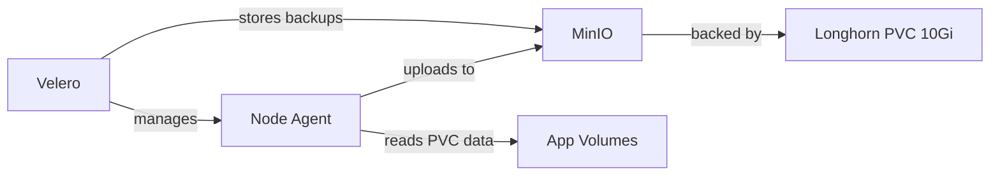
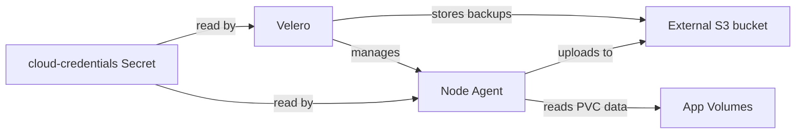

# Backup & Restore

Kipper includes automatic backup and restore powered by [Velero](https://velero.io). The default daily schedule backs up user resources and persistent volume data, with the namespace exclusions described below.

There are two storage modes:

- **In-cluster MinIO (the default on Longhorn clusters).** Zero configuration, no external account required. Backups live on Longhorn-backed storage on the same host as the cluster.
- **External S3-compatible storage** (AWS S3, Cloudflare R2, self-hosted MinIO, B2, Wasabi, Spaces). Backups live off-cluster and survive a `kip cluster uninstall` or a host failure.

For any cluster that holds data you cannot afford to lose, configure external storage at install time. See [External backup storage](/en/installation#external-backup-storage) on the installation page for the flags.

A cluster with [local storage](/en/nano) runs Velero only after you configure external storage, because a backup on the same disk would be lost if the disk failed. Until then, `kip backup` and the console's Backups page explain that backups are not configured, and `kip node reboot` reboots without its usual backup. To add external storage later, run `kip install` again with `--backup-storage-bucket` and its related flags. Read [Re-running install](/en/installation#re-running-install) first, because a re-run resets users created in the console.

## Automatic backups

A daily backup runs at 3:00 AM and is retained for 7 days. This is configured during `kip install` and runs automatically.

```bash
kip backup schedules
```

```
  NAME                      SCHEDULE        STATUS       LAST BACKUP
  velero-daily-apps         0 3 * * *       Enabled      2026-03-18T03:00:00Z
  velero-weekly-system      0 4 * * 0       Enabled      2026-03-15T04:00:00Z
```

## Manual backups

### Back up everything (user namespaces)

```bash
kip backup create
```

This skips the system namespaces (`kube-system`, `kube-public`, `kube-node-lease`, `traefik`, `longhorn-system`, `keda`, `monitoring`, `velero`) and the restore drill's namespace (`kipper-restore-drill`), and captures everything else. The daily schedule uses the same exclusion. Excluding `velero` prevents the backup from capturing the MinIO volume that stores its own output.

### Back up the system namespaces too

```bash
kip backup create everything --include-system
```

Use this when your recovery plan requires system resources. It also captures every cluster-wide object, such as ClusterIssuers and ClusterRoles. Review the storage warning above before including Velero’s own namespace.

Even here, cert-manager's transient issuance objects (CertificateRequests, Orders, Challenges) stay out of the backup. cert-manager recreates them on demand; restoring stale issuance state can interfere with renewal.

### Back up a specific project

```bash
kip backup create --project blog --environment test
```

### Back up with a custom name

```bash
kip backup create pre-migration --project blog
```

### List backups

```bash
kip backup list
```

```
  NAME                                STATUS       NAMESPACES           CREATED           DUMPS
  velero-daily-apps-20260318030000    Completed    all except system    2026-03-18 03:00  complete (2)
  pre-migration                       Completed    blog-test            2026-03-18 14:30  complete (1)
  manual-20260318-153000              Completed    all except system    2026-03-18 15:30  -
```

`all except system` means the system-namespace exclusion was applied. `all` means `--include-system` was passed, so no namespace was skipped. A namespace name means the backup was scoped via `--project`. DUMPS reports the status of [consistent database dumps](#consistent-database-dumps) and counts their volumes: `pending` while the backup runs, `complete (n)` when the backup completed, all recorded dump volumes were copied, and hook attempts were recorded without failures. `failed` means the backup, a hook or a volume copy failed, or hook attempts are missing. `-` means validation failed or a completed backup has no dump records or hook failures. `unknown` means a failed backup has neither dump records nor hook failures, or kip cannot read the volume copy records.

### Consistent database dumps {#consistent-database-dumps}

A volume backup copies a running database's files, so restoring it requires crash recovery. New Postgres services therefore also put a `pg_dump` of every database into each backup. Before Velero copies the service's volumes, a hook in the Postgres container dumps each database from one snapshot, counts every table's rows in that same snapshot, and dumps the roles. The dumps go to a separate dump volume of the same size as the data volume, which the backup copies along with the data, and a hook removes them once the copy is done. A manifest next to the dumps lists each database with its dump's size, SHA-256 checksum and `pg_dump` exit code, and ends with `complete true` when all dump and row-count sessions succeed.

If a dump fails, Velero continues with the volume backup and records the hook failure. `kip backup list` shows `failed` in the DUMPS column for that backup. The hook refuses to start unless the dump volume has room for the data directory excluding the write-ahead log. Insufficient free space on the dump volume can show `failed` even for a healthy database. Increasing the service's storage expands both volumes when the storage class supports expansion. Where the dump volume shares a disk with the database, as local volumes do, it also keeps the larger of 2 GiB and a tenth of that disk free. A database whose name contains a line break or a tab makes the dump fail, because the manifest cannot record it.

Enable or disable consistent dumps for an existing service. Changing the setting restarts the database once:

```bash
kip service update mydb --consistent-backups
kip service update mydb --consistent-backups=false
kip service add postgres --name mydb --consistent-backups=false   # Create a service with consistent dumps disabled.
```

For a Postgres service declared in `kipper.yaml`, set `consistentBackups: true` to enable consistent dumps. Omitting this field from the service's manifest entry disables consistent dumps when the manifest is applied. If the field is currently set, `kip apply` lists it as a field to be cleared and requires `--force` to proceed. Each database uses a consistent snapshot. Databases are dumped sequentially, so their snapshots represent different points in time. Each service stores its current set of dumps on its own dump volume and removes the previous set before starting a new one.

The dump volume always keeps one copy, regardless of how many copies the service has, because the next backup writes its contents again. If the disk holding that copy fails, Longhorn reports the dump volume as faulted. Consistent dumps then fail, and the database pod cannot start again until the dump volume is replaced. A running pod continues running until it restarts. Kipper checks every minute and raises a [warning alert](/en/alerts#faulted-dump-volumes). You decide when to delete the dump volume. `kip service info` shows a warning with the command that replaces it:

```bash
kip service recreate-dump mydb
```

kip checks that Longhorn reports the dump volume as faulted, that the dump volume, StatefulSet and any existing pod belong to the service, and that no backup of the namespace or restore into it is still running, because restarting the pod would interrupt that work. It refuses if it cannot read the backup and restore status. It asks for confirmation, then repeats all these checks before deleting the dump volume and restarting the database pod. `--yes` skips only the confirmation prompt. The controller creates a new, empty dump volume. The data volume is left unchanged. If the data volume is faulted too, kip says so, because the pod still cannot start afterwards. See [When a node dies](/en/maintenance#when-a-node-dies).

## Restoring from a backup

### Restore to the same namespace

```bash
kip backup restore pre-migration
```

### Restore to a different namespace

Useful for testing a restore without affecting the live environment:

```bash
kip backup restore pre-migration --namespace-mapping blog-test:blog-restored
```

This restores only `blog-test` into `blog-restored`. If you also pass `--namespace`, it must match the source namespace (`blog-test`).

The copy excludes the source's Ingresses because they would claim the live app's hostnames. It also excludes cert-manager Certificates because they would keep renewing certificates for those hostnames. Pass `--include-ingresses` to restore both. The copy's Secrets and connection settings retain references to the source environment's services, so check them before allowing the copy to connect.

### Test a restore with a drill

A drill tests whether services from the latest completed backup can be restored in a separate namespace while keeping the live environment running:

```bash
kip backup drill blog-prod
```

It restores the database and other service pods of `blog-prod`, with their volumes and credentials, into `kipper-restore-drill` from the latest completed backup that covers `blog-prod`. The files of the namespace's shared volumes and project shared storage are restored through their holder pods. App pods, Deployments, Jobs, CronJobs and Ingresses are excluded to avoid starting applications that could connect to the live database or claim live hostnames. Before restoring anything, kip creates a NetworkPolicy that allows traffic between drill pods and outgoing queries to the cluster's DNS. Enforcement requires a NetworkPolicy controller. k3s runs one unless started with `--disable-network-policy`. Kubernetes still allows traffic between a pod and its node.

Before the restore starts, kip estimates the storage the drill needs, on Longhorn or on local disks. It multiplies each selected volume's current size by its storage class's copy count, capped by the eligible nodes on this cluster and with a minimum of one copy, then adds the results. A local volume counts once. A backup taken before volumes were added, removed or resized restores different sizes, so the estimate is a guide.

kip then checks that every PVC-backed volume of the restored services and holder pods has a completed volume restore, reports each shared volume as `files restored`, waits for each service to become ready, and counts rows in its user tables with `count(*)`. For Postgres, it checks all connectable, non-template databases and includes the database and schema in each table name. For MySQL, it checks tables outside the system schemas and includes the database in each table name. Direct counts remain useful after crash recovery resets Postgres statistics during startup of a restored volume. Other service types are reported as restored without a row check.

When a restored Postgres service carries a consistent dump, kip also tests the logical restore. It checks that the manifest marks the dump as complete and that each dump matches its recorded SHA-256 checksum. It then restores each database's dump into a scratch database inside the drill namespace and compares the exact per-table row counts with the counts recorded from the dump's snapshot. A dump that is incomplete, altered or restores with different counts fails the drill. Restoring the dumps requires free space on the restored data volume for a second copy of each database.

The drill's volumes keep their storage class, so a volume with two copies asks for two in the drill too. When Longhorn cannot place every copy, kip warns that the volume has fewer copies than configured. That is harmless for the drill's scratch copy.

The drill's copy of each service needs enough resources on a node. If kip observes a restored pod staying unschedulable for two minutes, for example because the node has no CPU or memory available, kip stops waiting, reports the scheduler's reason and leaves the restore running. Resolve the scheduling error or end the restore with `kip backup restore --cancel <restore>` (see [Cancel a stuck restore](#cancel-a-stuck-restore)). Then remove the namespace with `kip backup drill <namespace> --clean`. `kip service restore-dump` behaves the same way.

kip refuses a drill on a cluster with the `nano` profile. Running a second copy of every service in the namespace exceeds a small server's memory capacity. To check one Postgres service's backup on a `nano` cluster, restore its database dump with `kip service restore-dump`. The limit will be lifted once drills run reliably on small servers.

Finally, kip prints the backup's name and completion time and requests deletion of the drill namespace unless `--keep` is set.

| Flag | Default | Description |
|---|---|---|
| `--backup` | the latest completed backup that covers the namespace | Backup to restore |
| `--keep` | `false` | Keep the drill namespace for inspection |
| `--clean` | `false` | Only delete a drill namespace left by `--keep` or an interrupted drill, after waiting for any drill restore still running |

Record each drill's date and result with your compliance records because kip does not retain them. The drill namespace is excluded from the schedules and from `kip backup create` by default. A backup made with `--include-system` can include a retained drill.

If you interrupt a drill without `--keep`, kip requests deletion of the drill namespace if its restore has already finished or is absent. If the restore is still running or its state cannot be checked, kip leaves the namespace and tells you to run `kip backup drill <namespace> --clean` later.

### Restore a Postgres dump into a new service

A volume restore brings a database back as it was on disk. To recover a database from its consistent dump, restore the dump into a new, empty Postgres service in the same namespace:

```bash
kip service add postgres --name mydb-restored
kip service restore-dump mydb --to mydb-restored
```

kip restores only the backup's copy of `mydb` into the isolated drill namespace: its pod, its credentials and TLS objects, and its data and dump volumes. The restore excludes the namespace's other services and their volumes, so the node needs room for one service's volumes. The data volume is included because Velero restores a volume's files through the pod that mounted it, and the Postgres pod mounts both the data and dump volumes.

The restored copy's database container requests only 1m CPU and 1 MiB of memory and keeps the limits recorded in the backup. These smaller requests help the copy fit alongside the source and target, although scheduling still depends on the node's available capacity. The database still needs memory to run and can use up to those limits. A Velero resource modifier in the `velero` namespace sets these requests. Velero also adds a `restore-wait` init container to the pod, and Kipper configures it to request 10m CPU and 16 MiB of memory. A cluster installed with an earlier release gets this setting with a full `kip upgrade`. Kipper preserves an operator's restore helper settings if their ConfigMap has a different name from Kipper's `fs-restore-action-config`. Cleanup removes the modifier before requesting deletion of the drill namespace.

kip checks the dump manifest and every dump's SHA-256 checksum before writing to the target. Each database is then streamed through the Kubernetes API into `mydb-restored` in one transaction, so a dump that fails to load or arrives truncated leaves that database empty. If the connection to the target drops during a load, kip cannot tell whether that transaction committed and says so. Afterwards the per-table row counts must match the counts recorded with the dump. Resource tuning is paused for the target during the restore.

At the end, kip requests deletion of the drill namespace if the Velero restore has finished or is absent. If the restore is still running or its state cannot be checked, kip leaves the namespace and prints cleanup instructions. If a restore fails partway through, delete and recreate the target before trying again because databases restored before the failure remain in it.

The target must have no user tables in any connectable, non-template database. kip checks this before the restore starts and again immediately before the first load. If an app bound to the target creates tables between these checks, kip refuses the restore to protect those tables. A new Postgres service that requires TLS starts only once its certificate is issued. Until then, kip explains that the restore must wait for the certificate. Roles and grants are not restored. Every restored object belongs to the target's own user, which is also the user its bindings connect as, so apps can access the restored data once you bind them with `kip service bind mydb-restored <app>`. Use `--backup` to choose a specific backup instead of the default, the latest completed backup covering the namespace. `--project` and `--environment` select the namespace. Drills and dump restores share the drill namespace, so only one can run at a time.

### Restore projects

Backups also include Kipper's cluster-wide objects: projects, their resource adjustments, the platform configuration and the cluster identity. Restores exclude these by default. To restore projects and their resource adjustments, run:

```bash
kip backup restore pre-migration --cluster-resources
```

`--cluster-resources` restores projects and their resource adjustments. By default, Velero skips existing objects, preserving live project settings. This flag cannot be combined with `--namespace-mapping`. The platform configuration and cluster identity are always excluded from restores because each cluster creates its own during installation.

### Copies after a restore

A restored volume keeps the storage class it was backed up with, and so the number of copies that class keeps. On a cluster with fewer nodes that can hold copies, Longhorn reports the volume degraded until enough nodes are available, and `kip status` lists it under copies that need attention. The volume's files are complete either way.

### Restore progress and credentials

`kip backup restore` waits up to four hours for Velero to finish and reports phase changes as it polls. Press Ctrl-C to stop waiting; the restore continues in the cluster.

After a `Completed` or `PartiallyFailed` restore, kip checks restored service credentials Secrets. Those with no live owner need to be re-attached to their matching service. On a terminal, kip lists the affected services and asks for confirmation. Confirm only if nobody else could write Secrets in those projects during the restore, since repair relies on labels that those writers could also set.

The published environment of an app, function or job and a MongoDB service's shell configuration can also be restored without an owner. Kipper re-attaches these automatically, without prompting, when their identity labels match the workload or service and their contents match exactly what it would write.

After the credentials check, a `PartiallyFailed` restore returns an error, even if credential repair succeeds.

For an unattended restore, pass `--repair-credentials` under the same condition. If you decline, or run without a terminal and omit the flag, kip shows how to repair the credentials later with `kip service credentials --repair`.

### Operator access list after a restore

A restore that recreates the `kipper-access` ConfigMap in `kipper-system` can bring back an older [operator access list](/en/security#operator-access) than the nodes enforce. kip then refuses access changes and `kip node add` to avoid reopening prefixes the newer list revoked. Run `kip cluster access apply --accept-older-record` to see what the record would admit again on each node and apply it. Once that apply succeeds, `allow` and `revoke` work from the restored list again. To keep the newer list instead, restore the record from a backup of `kipper-system` taken after that list was applied.

### Cancel a stuck restore

Velero works on one restore at a time. A restore stuck in `InProgress`, for example while waiting for a volume restore that never finishes, holds up every restore and drill behind it. A drill lists the names of restores ahead of it in the queue. Cancel a restore by name:

```bash
kip backup restore --cancel restore-blog-prod-20261019-090611
```

kip asks Velero's node agent to cancel the restore's unfinished volume restores, which usually lets the restore end as `PartiallyFailed`. If it is still `InProgress` after five minutes, kip restarts the Velero server, which marks `InProgress` restores `Failed` when it starts. A restart also fails backups and other restores that are `InProgress`. Unless you pass `--force`, kip blocks the restart and lists their names. A backup that starts after this check can still be affected by the restart.

kip reports success only once the restore has ended and none of its volume restores is still running. The Restore object is retained as a record of what happened. Objects and volume data restored before cancellation remain in place and may be incomplete, so remove a drill's namespace afterwards with `kip backup drill <namespace> --clean`.

This command cannot cancel restic volume restores or restores that use CSI data movement.

### Partially failed backups

`kip doctor` and `kip status` warn when the newest finished backup of a schedule partially failed, and fail when it failed. `kip backup describe <name>` shows why:

```bash
kip backup describe velero-daily-apps-20260318030000
```

It prints the backup's status, error and warning counts when either is non-zero, available start, completion and expiry times, and item counts when Velero reports a total. It also shows each recorded file-system volume backup, including Velero's message for failed volumes, and the error and warning messages Velero recorded. Velero stores those messages with the backup, so kip asks Velero for a short-lived download link and fetches them from your machine. This works with AWS S3 or another external store reachable from your machine. In-cluster MinIO is reachable only within the cluster. If kip cannot fetch the messages, it reports the problem and prints the remaining details.

`kip backup restore` requires `--allow-partial` to restore a backup marked `PartiallyFailed`, because restored data or resources may be incomplete. Choose a `Completed` backup when possible. If you proceed with `--allow-partial`, kip warns about missing data and lists volumes with failed or canceled backups when those details are available.

### CPU and memory after a restore

A restore recovers resource settings and their field ownership. User-set CPU and memory values therefore remain user settings. If ownership cannot be restored for an App value, Kipper holds it unchanged until you confirm it or enable automatic sizing. See [Values Kipper cannot attribute](/en/resource-management#held-values).

Resource tuning records are excluded from backups. After a restore, Kipper creates new records from the current workload allocation, collects fresh usage readings and starts without the previous OOM cooldown or pending recommendation.

## Mirror an S3 bucket into a locked bucket {#backup-mirror}

Velero backs up what lives in the cluster. Files an app keeps in an external S3 bucket, such as uploaded documents, are outside its reach. `kip backup mirror` copies such a bucket once a day into a second bucket at another endpoint, where S3 Object Lock in compliance mode keeps every copied version for a fixed number of days. Within that period nobody can delete or shorten the lock, including whoever holds the mirror's key and the account owner.

The mirror runs as a CronJob in the `velero` namespace. Every run first checks that the protection is in place and refuses to copy anything when it is not. Then it runs `rclone sync` and `rclone check`, so deletions in the source become delete markers in the mirror and the check confirms that every source object arrived. Each upload asks for a compliance lock as long as the bucket's default retention, which makes rclone send the checksum that S3 requires of a write into a locked bucket. A default given in years is counted in calendar days plus one, so no upload is locked for less than the default. Any S3-compatible store that supports versioning and Object Lock works.

Both endpoints must support HTTPS and be reachable from your machine because `kip` checks them before creating the mirror. The cluster's built-in backup storage uses plain HTTP inside the cluster, so it cannot be a mirror source.

### Prepare the buckets

Set the buckets up with your provider's console or the AWS CLI before running `kip`. Kipper creates no buckets and changes no bucket settings.

**Source bucket.** Turn on versioning, so the source keeps deleted and overwritten objects. A lifecycle rule that expires noncurrent versions after the retention period keeps the bucket from growing without bound.

**Mirror bucket.** Create it at a different endpoint, ideally in a separate account or project whose keys the app never holds. Many providers, Hetzner among them, allow Object Lock only on a new bucket, so create the bucket with it:

```bash
aws --endpoint-url https://eu-2.objects.example.com s3api create-bucket \
  --bucket app-uploads-backup --object-lock-enabled-for-bucket
aws --endpoint-url https://eu-2.objects.example.com s3api put-object-lock-configuration \
  --bucket app-uploads-backup \
  --object-lock-configuration '{"ObjectLockEnabled":"Enabled","Rule":{"DefaultRetention":{"Mode":"COMPLIANCE","Days":30}}}'
```

Add the same noncurrent-version lifecycle rule to the mirror bucket. The lock keeps each version until it expires, and the lifecycle rule removes it afterwards.

**A compliance lock cannot be undone.** A wrong retention or the wrong bucket leaves data you pay for and cannot delete until every lock expires, and the bucket cannot be deleted before then. Try the whole setup on a throwaway bucket with a one-day retention first.

**Keys.** The mirror reads the source and writes the mirror bucket. Grant it no more than this:

- On the source bucket: `s3:ListBucket`, `s3:GetBucketVersioning`, `s3:GetObject` and `s3:GetObjectVersion`. Nothing that writes or deletes.
- On the mirror bucket: `s3:ListBucket`, `s3:GetBucketObjectLockConfiguration`, `s3:PutObject`, `s3:PutObjectRetention`, `s3:GetObject`, `s3:GetObjectVersion`, `s3:GetObjectRetention` and `s3:DeleteObject`. A compliance lock can only be extended, never shortened, so `s3:PutObjectRetention` cannot weaken it. The checks also try `s3:DeleteObjectVersion` on the canary, which the lock refuses.

One key from the mirror's account, granted the source actions through a bucket policy on the source, can serve both sides. With two different keys, give the target key no access to the source at all, because the checks only probe the source with the source key.

### Add the mirror

Both credentials files use the AWS format, the same as `--backup-storage-credentials` at install time. Pass the same file twice when one key serves both sides:

```bash
kip backup mirror add uploads \
  --source s3://eu-1.objects.example.com/app-uploads --source-region eu-1 \
  --target s3://eu-2.objects.example.com/app-uploads-backup --target-region eu-2 \
  --source-credentials ~/.aws/mirror --target-credentials ~/.aws/mirror \
  --retention-days 30
```

```
  Checking s3://eu-1.objects.example.com/app-uploads and s3://eu-2.objects.example.com/app-uploads-backup...

  ✔  endpoints differ: eu-1.objects.example.com and eu-2.objects.example.com
  ✔  source versioning: enabled on s3://eu-1.objects.example.com/app-uploads
  ✔  target object lock: COMPLIANCE, 30 days
  ✔  canary write: version 7d0c920e-222e-440a-ac80-68a359c987da
  ✔  canary retention: locked until 2026-11-19T03:00:00Z
  ✔  canary delete refused: access denied: Access Denied
  ✔  source write refused: write, delete and version delete of .kipper-mirror/canary denied

  ✔  Created Secret and CronJob backup-mirror-uploads in velero, schedule "0 3 * * *"
  ✔  Added alert KipperBackupMirrorStale for no successful run within 48h
```

`add` runs the checks from your machine and creates cluster resources only after all of them pass. The CronJob repeats them before every copy:

| Check | Passes when |
|---|---|
| endpoints differ | The source and mirror use different endpoints |
| source versioning | Versioning on the source is `Enabled` |
| target object lock | The mirror bucket has Object Lock with a `COMPLIANCE` default retention of at least `--retention-days` |
| canary write | A one-byte object written to `.kipper-mirror/canary` in the mirror gets a version ID |
| canary retention | That version is locked in compliance mode for about the bucket's default retention |
| canary delete refused | Deleting that version is refused with `AccessDenied` or a lock error, and the version is still there afterwards |
| source write refused | Writing, deleting and deleting a version of the canary key in the source with the source key each get `AccessDenied` |

The canary versions stay in the mirror until their locks expire, one per run. The sync and the check skip `.kipper-mirror/`. The source probes touch only the canary key, which is reserved for these checks. They show that the source key cannot write or delete there. A bucket policy that grants writes on other prefixes would pass, so keep the source grant to the read actions listed above.

| Flag | Default | Description |
|---|---|---|
| `--source`, `--target` | (required) | Buckets as `s3://endpoint/bucket` |
| `--source-region`, `--target-region` | (required) | Region as the provider names it |
| `--source-credentials`, `--target-credentials` | (required) | AWS-format credentials files |
| `--source-profile`, `--target-profile` | `default` | Profile within each file |
| `--retention-days` | (required) | Minimum default retention of the target bucket, in days |
| `--schedule` | `0 3 * * *` | Cron schedule, in the cluster's time zone |
| `--max-delete` | `-1` (off) | Maximum objects one run may delete from the target. Exceeding it fails the run without a retry |
| `--image-tag` | | Run the mirror image built from this commit |

Set `--max-delete` above the largest number of deletions you expect in a normal day. When a mass deletion at the source reaches the limit, rclone stops, the run fails without a retry and the failed-job alert fires. Deletions up to the limit have already been mirrored as delete markers, and the locked versions behind them stay. The limit applies to each scheduled run on its own, so later runs keep mirroring deletions up to the limit and succeed again once the remaining deletions fit within it. When the alert fires and the deletions should not reach the mirror, run `kip backup mirror remove` and add the mirror again after restoring the source.

To change the schedule, keys or retention, remove the mirror and add it again.

### Check on it

```bash
kip backup mirror status uploads
```

```
  Backup mirror uploads

  Source        s3://eu-1.objects.example.com/app-uploads
  Target        s3://eu-2.objects.example.com/app-uploads-backup
  Retention     at least 30 days, compliance lock
  Max delete    off
  Schedule      0 3 * * *
  Last run      2026-10-20 03:00 UTC (5h ago), succeeded
  Last success  5h ago
  Preflight     passed
  Sync          12 copied (3 MiB), 2 deleted, 1200 checked, 0 errors in 12s
  Check         passed
```

Without a name, `status` shows every mirror. A failed run, including a failed check, raises the usual failed-job alert through the cluster's [alert channels](/en/alerts). `add` also installs a Prometheus rule, `KipperBackupMirrorStale`, that fires when the mirror has had no successful run for twice its schedule interval, which also catches a CronJob that has stopped running. The condition must hold for 15 minutes before the alert fires. That rule appears in Grafana under Alerting. The monitoring stack ships without Alertmanager, so the rule sends no notifications on its own.

### Remove the mirror

```bash
kip backup mirror remove uploads
```

This deletes the CronJob, the Secret holding both keys and the alert rule. Both buckets and everything in them stay as they are.

### Restore from the mirror

Restore with rclone directly from any machine, without cluster access. Kipper has no restore command for mirrors. Configure an rclone remote named `mirror` with a key that can read the mirror bucket's versions, and one named `source` with a key that can write to the bucket you restore into. The mirror's own source key is read-only and cannot restore.

Restore one object as it was at a point in time by copying the old version forward. The `version_at` option on the `mirror` remote picks the version that was current at that time, and the object's current version in the source stays behind as a noncurrent version:

```bash
rclone copyto \
  "mirror,version_at='2026-10-18T12:00:00Z':app-uploads-backup/invoices/2026/report.pdf" \
  source:app-uploads/invoices/2026/report.pdf
```

Set `version_at` on the reading remote only. rclone refuses to write to a remote that has it.

After losing the source bucket, copy the mirror into a new bucket and point the app at it. Leave out `version_at` for the latest state, or set it to restore the bucket as it was at an earlier time:

```bash
rclone copy --exclude "/.kipper-mirror/**" mirror:app-uploads-backup new:app-uploads-restored
```

Practise a restore regularly into a scratch bucket, then compare it with `rclone check --one-way --exclude "/.kipper-mirror/**" mirror:app-uploads-backup scratch:restore-drill` and record the date and result. If deleted data has to stay deleted, for example after an erasure request, keep a record of what was erased and erase it again from anything you restore.

### Mirror limits

- A mirror is a daily copy. Anything written since the last successful run is not in it yet.
- The lock protects each mirrored version for the retention period after it was copied, and no longer. An object that stays unchanged for longer keeps its copy in the mirror, but that copy is no longer locked, so a key allowed to delete versions in the mirror bucket could delete it. Where your provider lets you, give the mirror's key no `s3:DeleteObjectVersion` on the mirror bucket.
- The sync and the check compare MD5 checksums where the store provides them. Objects your app uploaded in parts carry no plain MD5 checksum, so rclone compares only their sizes. An object overwritten in place with new content of exactly the same size is then not copied again. The check output counts such objects as hashes that could not be checked. Apps that write a new key for each new file are not affected.
- An object added to the source between the sync and the check fails the check. The Job retries twice, and the next run picks the object up.
- Both keys sit in a Secret in the `velero` namespace. Anyone who can read that Secret can read every object in the source.

## What gets backed up

| Resource | Backed up? | How |
|---|---|---|
| Deployments, Services, Ingresses | Yes | Kubernetes resource definitions |
| ConfigMaps, Secrets | Yes | Kubernetes resource definitions |
| Environment variables and app secrets | Yes | Workload specs and Kubernetes Secrets |
| PostgreSQL data | Yes | PVC data via Kopia file-system backup |
| Redis data | Yes | PVC data via Kopia file-system backup |
| Longhorn volumes | Yes | Full file-system backup of volume contents |
| Shared volumes and project shared storage | Yes | File-system backup through a holder pod, whether or not an app mounts the volume |
| Projects and resource adjustments | Yes | Restored only with `--cluster-resources` |
| Platform configuration and cluster identity | Yes | Included in backups and always excluded from restores |
| Resource tuning records | No | The auto-sizer rebuilds them from the running workloads |

## Architecture

### In-cluster MinIO (default)



- **Velero** orchestrates backups and restores
- **Node Agent** (DaemonSet) reads actual file data from persistent volumes using Kopia
- **MinIO** provides S3-compatible storage inside the cluster
- **Longhorn** provides durable storage for MinIO itself

### External S3-compatible storage



- **External bucket** lives in AWS S3, Cloudflare R2, self-hosted MinIO, B2, Wasabi, DigitalOcean Spaces, or any other S3-compatible service
- **cloud-credentials Secret** in the `velero` namespace holds the access key, written from the credentials file you passed at install time
- The Velero HelmChart references the Secret by name; the credentials never appear in any HelmChart CR or kubectl-apply output
- Local `~/.kip/config.yaml` records mode + bucket + region + endpoint, never the keys
- With `--backup-storage-sse-c`, the store encrypts Velero's own objects with a key in the `kipper-backup-sse-key` Secret, and volume data stays encrypted by the backup repository key. See [SSE-C](/en/installation#backup-sse-c)

To rotate keys later, run `kip install` again with the updated credentials file pointing at the same host. That replaces the Secret in place. Note it re-runs the rest of the install too, which is not free: see [what an upgrade moves](/en/maintenance#what-an-upgrade-moves-and-what-it-does-not).

## Retention

Default retention is 7 days (`168h`). To create a backup with custom retention:

```bash
kip backup create --ttl 720h  # 30 days
```

## Limitations

- **In-cluster mode**: backups are stored inside the cluster, so a host loss or `kip cluster uninstall` takes the backups with it. Configure [external backup storage](#external-s3-compatible-storage) for clusters that hold data you care about.
- Kipper's backups copy files from volumes mounted by regular containers in running pods. Without such a mount, a backup saves the volume's Kubernetes objects but none of its files. This includes volumes used only by an app stopped with `kip app stop`. [Shared volumes and project shared storage](/en/shared-storage#backups) are the exception, because each has a holder pod that keeps it mounted while backups are configured. When backups exist and it can read the cluster's pods and volumes, `kip backup list` names volumes in user-workload namespaces whose files a backup would omit with the current mounts. It skips volumes explicitly labelled for exclusion from backups. Start the app before the backup runs, or remove a volume you no longer need.
- Database volumes are copied while the database runs. Postgres services with [consistent backups](#consistent-database-dumps) also include a `pg_dump` per database. MySQL and MongoDB include only the volume copy, so use their native tools alongside Velero when you need a logical dump.
- Backup storage mode is chosen at install time, and there is no command that migrates a running cluster from one mode to another. **Do not uninstall in order to switch.** In in-cluster mode the backups live on the cluster, so `kip cluster uninstall` removes them along with everything else, and a backup taken just beforehand is gone before you can restore it. Re-running `kip install` with `--backup-storage-bucket` does repoint Velero at external storage, but it leaves your existing backups behind and re-runs the rest of the install, so it is a deliberate change rather than a migration. The route that keeps your data is to install a second cluster with external storage and move workloads onto it. See [One-shot decision](/en/installation#one-shot-decision).
