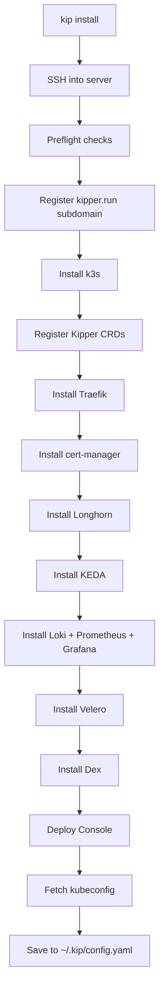

# Installation Reference

For your first cluster, follow [Getting Started](/en/getting-started). This page covers installation flags, server requirements, and setup details.

## kip install

Installs a production-ready Kubernetes cluster on a remote Linux server.

```bash
kip install --host <ip> [flags]
```

### Flags

| Flag | Required | Default | Description |
|---|---|---|---|
| `--host` | Yes | — | IP address or hostname of the target server |
| `--ssh-key` | No | see below | Path to SSH private key. Saved to `~/.kip/config.yaml` so subsequent `kip` commands inherit it. If unset, `kip` reads `KIP_SSH_KEY`, then `cluster.ssh_key` from config; if still unset, ssh consults your ssh-agent and `~/.ssh/config` as normal |
| `--ssh-user` | No | Saved user for this host, otherwise `root` | User to log in as. A user other than root needs passwordless sudo, and kip runs every command through `sudo -n`. Saved to `~/.kip/config.yaml` as `ssh_user`, and used for every node of the cluster. See [Logging in as a user other than root](#logging-in-as-a-user-other-than-root) |
| `--domain` | No | `<ip>.kipper.run` | The name the cluster serves on. A `*.kipper.run` name (`lab.kipper.run`) is registered for you on the shared gateway; anything else is a domain whose DNS you run yourself, and whose hostnames have to resolve to the server before you install (see [DNS for a domain you run](#dns-for-a-domain-you-run)). Omit it and the free name is derived from the server's address. See [choosing your own name](/en/domains#choosing-your-own-name) |
| `--admin-email` | No | `admin@<domain>` | Email for Let's Encrypt certificates and the admin account. Defaults to `admin@<domain>` when `--domain` is a domain you run, otherwise `admin@kipper.local` |
| `--org` | No | — | Organization short code (e.g. `acme`), used as namespace prefix |
| `--org-display-name` | No | — | Human-readable organization name (e.g. `Acme Inc`) |
| `--harden` | No | `true` | Disable surplus host services exposed on public interfaces (e.g. `rpcbind`, Cockpit). Pass `--harden=false` only when you manage host security yourself |
| `--admin-kubeconfig` | No | `false` | Write the shared k3s admin certificate to this machine instead of a per-operator OIDC kubeconfig. The certificate is unattributed and revocable only by rotating the cluster CA. A CI escape hatch, not the everyday path |
| `--no-login` | No | `false` | Skip the inline browser sign-in during install. The machine ends up with a credential-free kubeconfig; the first operator runs `kip auth login && kip auth verify` afterwards |
| `--credentials-file` | No | — | Save the generated admin email and password to a new file on the machine running `kip`. The path must differ from `--result`. Permissions are 0600 on Unix; Windows inherits the directory's permissions. Prints the file path on success or the credentials if saving fails. See [What install writes to your machine](#what-install-writes-to-your-machine) |
| `--firewall` | No | `true` | Configure the host firewall with rules for k3s: UFW on Ubuntu and Debian, firewalld on Rocky Linux, AlmaLinux and CentOS Stream. Preserves active firewalls you manage unless you grant permission to take over firewalld. Pass `--firewall=false` only when you manage host security yourself |
| `--adopt-firewall` | No | `false` | On Rocky Linux, AlmaLinux and CentOS Stream: authorize takeover of a running firewalld after safety checks. Interactive SSH installs show the proposed changes and ask for permission, including with `--via-server`. Use this flag for unattended installs; it authorizes replacement of the public zone present when takeover runs. Requires SSH or `--via-server`; unavailable with `--local`. See [Firewall on the RHEL family](/en/security#host-hardening) |
| `--no-ssh-rate-limit` | No | `false` | Disable UFW SSH rate limiting on Ubuntu and Debian. Kipper allows SSH without rate limiting on firewalld hosts. See below |
| `--allow-ssh-passwords` | No | `false` | Leave SSH password login as it is. By default, Kipper turns it off once a key-only login works. See [Key-only SSH](/en/security#key-only-ssh) |
| `--yes` | No | `false` | Approve migrating an existing cluster's pod network to WireGuard or recovering an interrupted migration. Migration restarts k3s, which makes the Kubernetes API unavailable for a short time (usually 10 to 30 seconds, longer on small or busy servers) while running containers keep serving; apps that call the API are affected for that time. Recovery may restore the previous configuration and restart k3s. When approval is needed, omitting this flag prompts in interactive installs or stops unattended installs before the network change |
| `--local` | No | `false` | Install on this machine; `--host` must reach it. See [Installing on the server itself](#installing-on-the-server-itself) |
| `--host-maps-here` | No | `false` | With `--local`: confirm that `--host` routes to this machine, such as through NAT |
| `--result` | No | — | With `--local`: save a result file to import on your management machine with `kip cluster add --install-result` |
| `--via-server` | No | `true` on Windows | Run a persistent install job on the server and stream its log. Enabled by default on Windows. See [Installing from Windows](/en/windows) |
| `--server-kip` | No | — | With `--via-server`: upload a local Linux `kip` binary; useful for unreleased builds |
| `--cancel` | No | `false` | With `--via-server` (the default on Windows): stop the running install on `--host` or discard its uncollected result |
| `--dns-resolver` | No | `1.1.1.1`, `8.8.8.8`, `9.9.9.9` | Upstream DNS resolver CoreDNS forwards external queries to. Repeatable, up to three IPv4 addresses (the resolv.conf nameserver limit; the cluster pod network is IPv4-only). Kipper forwards to reliable public resolvers instead of the host's `/etc/resolv.conf`, which varies by provider and can carry unreachable or rate-limited entries that break cluster DNS. The default sends your workloads' external DNS lookups to Cloudflare, Google, and Quad9. On private, split-horizon, or data-residency-sensitive networks, set your own resolvers (e.g. `--dns-resolver 10.0.0.53`), which is also how clusters resolve internal or corporate names. During install, Kipper checks each resolver is reachable from the server on port 53 and warns about any that are not |
| `--profile` | No | Selected from RAM and CPUs | Sizing profile: `nano`, `small`, `medium`, `large` or `xlarge`. The default uses the server's RAM and CPU count. See [Preflight checks](#preflight-checks). Existing clusters keep their recorded profile. To change it, use `kip platform profile set` |
| `--storage` | No | `local` for `nano`, `longhorn` otherwise | Volume storage: `local` keeps volumes on the server's disk and supports one node. Adding nodes requires `longhorn`. Existing clusters keep their storage mode. See [Start Small with Nano](/en/nano) |
| `--trusted-proxy` | No | — | IP or CIDR whose `X-Forwarded-*` headers Traefik honors. Repeatable. Set it when an external load balancer or proxy sits in front of the cluster, so apps and logs see real client addresses instead of the balancer's. The kipper.run gateway is trusted automatically; with no proxy in front, leave it unset and forwarded headers are ignored |
| `--backup-storage-bucket` | No | — | S3-compatible bucket name for Velero backups. When set, backups live off-cluster and survive a wipe. See [External backup storage](#external-backup-storage) below |
| `--backup-storage-region` | If bucket set | — | AWS region or provider equivalent. Use the actual region for AWS S3, `auto` for Cloudflare R2, whatever your provider expects elsewhere |
| `--backup-storage-endpoint` | No | — | S3 endpoint URL. Omit for native AWS S3 (Velero derives it from the region). Required for R2, self-hosted MinIO, B2, Wasabi, DigitalOcean Spaces |
| `--backup-storage-credentials` | No | `~/.aws/credentials` | Path to an AWS-style INI credentials file. Read only at install time and never stored back on disk |
| `--backup-storage-profile` | No | `default` | Profile name inside the credentials file. Lets you reuse an existing AWS CLI profile like `acme` without copying it to a separate file |
| `--backup-storage-sse-c` | No | `false` | Encrypt backup objects with a customer-provided key (SSE-C) that kip generates on the server. Requires an external HTTPS S3-compatible store and a bucket without backups. See [SSE-C](#backup-sse-c) |
| `--backup-storage-sse-c-key-file` | To recover from SSE-C backups | — | File containing the SSE-C key used to encrypt the bucket's backups, as saved by `kip backup sse-key export`, mode 0600 |
| `--backup-repository-key-file` | If the bucket holds backups and the cluster has no key | — | File containing the key used to encrypt existing volume backups, mode 0600. See [The backup repository key](#backup-repository-key) |

#### DNS for a domain you run

`--domain example.com` puts the console on `console.example.com`, the API on `console-api.example.com` and the login on `dex.example.com`, and every app you deploy afterwards gets its own host under the same domain. cert-manager issues a Let's Encrypt certificate for each of those hosts and solves the HTTP-01 challenge against it, so each one has to resolve to the server.

One wildcard A record covers all of them, including the apps you have not deployed yet:

```
*.example.com.   A   203.0.113.10
```

Individual records work too, so long as `console`, `console-api` and `dex` exist before you install and you add another for every app you deploy afterwards.

The install looks up `console`, `console-api` and `dex`, including any per-host overrides, and warns when any of them do not resolve yet; it still continues, because DNS may only be minutes from propagating. The check asks only whether each name resolves somewhere, so a record pointing at the wrong address still passes. Separately, an install that ends in a browser sign-in waits up to five minutes for `dex.example.com` to answer its discovery URL over verified TLS, and tells you whether DNS or the certificate is what it is waiting for; if that never comes good it finishes anyway, with sign-in deferred. Four routes skip the wait: `--admin-kubeconfig`, `--no-login`, a run with no terminal, and a re-install by an operator whose session is still valid. Missing records still show up later as their own service failing: `console.` as a page that will not load, `dex.` as a sign-in that never completes, and `console-api.` as the `kip` commands that call the console API refusing to connect. The browser console is unaffected by that last one, because it reaches the API through `/api` on its own host.

Adding the record afterwards is enough on its own. cert-manager keeps retrying and issues once the hostnames resolve, and `kip auth login` finishes the sign-in that was deferred. See [troubleshooting certificates](/en/domains#troubleshooting-certificates).

#### Logging in as a user other than root

Cloud images from AWS, Google Cloud and Azure log you in as a default user such as `ubuntu`, `admin` or `ec2-user` and leave root login disabled. Pass that user with `--ssh-user`, and kip runs its commands through passwordless sudo, which those images grant the default user:

```bash
kip install --host 203.0.113.10 --ssh-user ubuntu --ssh-key ~/.ssh/id_ed25519
```

The user is saved with the cluster, so `kip upgrade`, `kip node add` and the other commands that connect over SSH log in the same way. Every node of the cluster needs the same user with the same key. If sudo asks for a password, kip stops and names the user. `--ssh-user` cannot be used with `--local`, which already runs as root.

#### SSH rate limiting

The default UFW rule rate-limits new SSH connections to six in thirty seconds from one source address. Kipper normally shares one SSH connection during installation.

Turn it off with `--no-ssh-rate-limit` if your legitimate traffic can look like a burst:

- CI that runs several `kip` commands in a row
- Two or more people administering the server from the same office or VPN address
- Any automation that opens SSH connections in quick succession

```bash
kip install --host 203.0.113.10 --domain example.com --no-ssh-rate-limit
```

You can change your mind later:

```bash
kip cluster harden --no-ssh-rate-limit
```

Kipper also skips the rate limit automatically when it cannot reuse a single connection throughout installation, for example when it cannot write to your home directory. The hundreds of connections needed in that case would hit the rate limit and lock Kipper out before installation finishes. Kipper displays a notice when it skips the limit. To add the limit later, run `kip cluster harden` from a machine where Kipper can reuse its SSH connection.

#### Installing on the server itself

For CI, cloud-init or a provider's user-data script, `kip` can run on the server and install it there, with no SSH connection at all:

```bash
kip install --local --host 203.0.113.10 --result /root/cluster-result.kip
```

Run as root with `HOME=/root`. Set `--host` to the address other machines use to reach the server; kip uses it for the cluster's certificate and API address. Hostnames must resolve on the server, and loopback addresses are rejected. If the address is absent from local interfaces, as with public addresses behind NAT, confirm that it routes to this server when prompted. For unattended installs, pass `--host-maps-here`.

Local installs defer browser sign-in to your management machine. Copy the result file there and import it:

```bash
kip cluster add --install-result --ssh-key ~/.ssh/id_ed25519 cluster-result.kip
kip auth login
```

`--ssh-key` records the local key path for maintenance commands such as `kip upgrade`, and `--ssh-user` records the login user when the server does not accept root logins. The result file holds the cluster's gateway credential and its settings, so keep it private and delete it once it is added. `--install-result` requires a new cluster name to protect existing entries. Run `kip cluster uninstall` from your management machine. It checks the recorded machine ID and local addresses to guard against uninstalling its own host.

## What it installs



### Preflight checks

Before installing, Kipper verifies:

- **OS:** Ubuntu 22.04, 24.04 or 26.04, Debian 12 or 13, or Rocky Linux, AlmaLinux or CentOS Stream 9 or 10. Red Hat Enterprise Linux itself is not supported yet. Ubuntu 20.04 and Debian 11 pass the OS check with a warning: standard support has ended, and Kipper no longer tests these releases.
- **RAM:** 2 GB minimum. A 2 GB server reports less RAM because some memory is reserved by the host, so the installer accepts at least 1800 MiB of detected RAM. The `nano` sizing profile disables monitoring. The installer recommends at least 8 GB for production workloads.
- **Disk with local storage:** a new cluster needs at least 10 GiB free on the filesystem holding k3s's data (`/var/lib/rancher/k3s`), with a warning below 20 GiB. Volumes, images and system data share that space. On an existing cluster, disk shortages produce warnings so installation can continue.
- **Disk with Longhorn:** preflight checks the filesystem holding Longhorn's data (`/var/lib/longhorn`, or `/var/lib` before installation). It budgets 20 GiB for fresh system volumes: 10 GiB for MinIO backups, 5 GiB for the Zot registry and 5 GiB for Loki logs. Disabling Loki saves 5 GiB, as the `nano` profile does by default. External backup storage saves another 10 GiB. The volume budget must fit within 70% of the filesystem, so the default setup needs at least 29 GiB of total capacity, or 22 GiB without Loki. After allowing for images and system data, more than 25% of the filesystem must remain free. The estimated installation footprint is 9 GiB with monitoring or 7 GiB without it, reduced by existing containerd usage. If k3s data is on a separate filesystem, preflight checks space for that footprint there. These checks use Longhorn's default thresholds. When `kip install` reads a saved platform profile, disk shortages produce warnings so the existing installation can be updated. A 40 GB disk with sufficient free space is a starting point. Allow extra capacity for apps, backups and expanded system volumes.
- **Kernel:** the server must be able to load the `wireguard` kernel module. If it cannot, host preparation stops and names the missing module. For an existing VXLAN cluster with no unfinished network change, re-running `kip install` can keep VXLAN with a warning if WireGuard is unavailable. Normal k3s upgrade rules still apply. Joining workers with `kip node add` requires WireGuard.
- **Ports:** 80 (HTTP), 443 (HTTPS), and 6443 (Kubernetes API) must not be in use by another service. The installer stops if something other than k3s, such as nginx or a Docker container, already listens on one of them

Kipper selects a sizing profile from detected RAM, using cutoffs of 6000, 7500, 15000, and 30000 MiB. Below 6000 MiB, monitoring is off by default to leave memory for the platform and apps. The higher cutoffs allow for memory reserved by the host. It then lowers the profile if estimated CPU requests leave less than 0.5 CPU for a default database service. For example, a server with 8 GB RAM and 2 vCPUs gets `small`. `nano` is the minimum, even when CPU capacity is insufficient.

Use `--profile` to choose a profile explicitly. Preflight warns if its estimated CPU requests leave too little room for a default database service. Existing clusters keep their recorded profile. If `--profile` specifies a different profile, the installer explains how to change it with `kip platform profile set`. See [Sizing profiles](/en/platform-resources#sizing-profiles) for memory ranges and component allocations.

::: tip Plan for your workload
The preflight minimums let you install Kipper. Choose additional CPU, memory, and disk capacity for your apps, persistent data, monitoring, and backups. Leave room for image downloads, startup peaks, and overlapping pods during updates.

The AI bundle has its own [memory and backup-storage checks](/en/ai#what-hardware-do-you-need). Measure performance with representative workloads before relying on a server size for production.
:::


If you're on the `small` profile and need more room for apps, disabling the monitoring stack frees ~1-2 GB:

```bash
kip platform disable prometheus
kip platform disable loki
```

The `nano` profile already disables monitoring. See [Platform Resources](/en/platform-resources) for the full picture.

### Components installed

| Component | Purpose |
|---|---|
| [k3s](https://k3s.io) | Lightweight Kubernetes distribution |
| [Traefik](https://traefik.io) | Ingress controller and reverse proxy |
| [cert-manager](https://cert-manager.io) | Automatic TLS certificates via Let's Encrypt |
| [Longhorn](https://longhorn.io) | Distributed persistent storage for Longhorn clusters. Local storage uses k3s's local-path provisioner. |
| [Dex](https://dexidp.io) | Identity provider (OAuth2/OIDC) |
| [Prometheus](https://prometheus.io) + [Grafana](https://grafana.com) | Metrics and dashboards (can be [disabled](/en/observability#disabling-monitoring)) |
| [Loki](https://grafana.com/oss/loki/) | Log aggregation (can be [disabled](/en/observability#disabling-monitoring)) |
| [Velero](https://velero.io) | Backup and restore. Local-storage clusters require external backup storage to install Velero. |
| [KEDA](https://keda.sh) | Event-driven autoscaling |
| Kipper Console | Web dashboard for cluster management |

### When an install fails

When an install step fails, `kip install` names the step and prints a link to a GitHub issue form. The link contains only details kip controls: the step, the kip version, your machine's OS, the server's distribution and version, the profile, and the names of the flags you set (without their values). Opening the link sends those details to GitHub to fill in the form. Submitting the form creates a public issue.

The last lines of the error appear below the link, between two marker lines, for you to paste into the form's Logs field. kip also tries to save a copy in a new `install-error-*.txt` file in `~/.kip` and prints its path. If saving fails, kip reports that failure and the excerpt remains available on screen. Before printing the excerpt, kip replaces known addresses, domains, email addresses, non-root SSH usernames, passwords, tokens and backup keys from the install, along with IP addresses, hostnames, email addresses, home directory users and credentials matched by its detection rules. Those rules preserve public dependency hosts, loopback, link-local and unspecified addresses, and the k3s pod and service IP ranges unless they match a known value from the install. Redaction is best effort, so a bare machine name or a secret in an unusual format can slip through. Read the excerpt before pasting it. Only the text between the markers is redacted this way. The rest of the terminal output may still contain private data.

A server-driven install, the default on Windows, also prints the link and excerpt. Its link identifies kip as running on the server and omits the names of the flags you set because the server receives their values without a record of which flags you explicitly set.

A failure early in the install often comes from the server itself, such as a package manager still busy with first-boot updates. Wait a few minutes and re-run the same command.

### Re-running install

Re-running `kip install` updates a component that is already there rather than duplicating it, and it keeps the serving identity recorded in the cluster (the domain and hosts for the console, API, and login) even when the cluster has moved to a different domain since the original install. Passing a conflicting `--domain` is an error: domain changes go through `kip cluster domain`, which keeps login available throughout the change.

`kip upgrade` is the routine way to catch a cluster up. Re-running the install is destructive in one specific way: it re-renders the Dex ConfigMap, which deletes every user account created through the console. Read [what an upgrade moves](/en/maintenance#what-an-upgrade-moves-and-what-it-does-not) before re-running it on a cluster that has any.

### External backup storage

On a Longhorn cluster, Kipper installs an in-cluster MinIO by default and points Velero at it. This provides automatic backups with zero configuration, stored on the cluster's own storage. A `kip cluster uninstall`, a hardware failure, or anything that wipes Longhorn data also wipes the backup bucket.

A local-storage cluster needs external storage for backups, because a backup on the same disk would be lost if the disk failed.

For a cluster you care about, point Velero at off-cluster object storage instead. The bucket must already exist, kip does not create it.

#### Native AWS S3

```bash
kip install \
  --host 203.0.113.10 \
  --domain example.com \
  --backup-storage-bucket example-kipper-backups \
  --backup-storage-region eu-west-1 \
  --backup-storage-profile acme
```

`--backup-storage-credentials` defaults to `~/.aws/credentials`. `--backup-storage-profile` defaults to `default`. Both `[NAME]` (the credentials file convention) and `[profile NAME]` (the config file convention) section headers are accepted.

#### Cloudflare R2 or other S3-compatible providers

```bash
kip install \
  --host 203.0.113.10 \
  --domain example.com \
  --backup-storage-bucket example-kipper-backups \
  --backup-storage-region auto \
  --backup-storage-endpoint https://<accountid>.r2.cloudflarestorage.com \
  --backup-storage-credentials ~/r2-credentials
```

Same shape works for self-hosted MinIO, Backblaze B2, Wasabi, and DigitalOcean Spaces. Set `--backup-storage-endpoint` to your provider's S3 URL.

#### Credentials handling

The credentials file is read once at install time and never written to disk again. Kipper creates a Kubernetes Secret (`cloud-credentials` in the `velero` namespace) on the cluster, and the Velero HelmChart references that Secret by name. Your local kip config records the bucket, region, and endpoint but never the keys.

`kip upgrade` re-applies the Velero chart without rotating the secret, so you do not need to keep the credentials file around after install. To rotate keys, run `kip install` again with the updated credentials file pointing at the same host, which replaces the Secret in place. It re-runs the rest of the install as well, so read [what an upgrade moves](/en/maintenance#what-an-upgrade-moves-and-what-it-does-not) before doing it on a cluster with console-created users.

#### The backup repository key {#backup-repository-key}

Velero encrypts volume backups with a repository key. On a new cluster, `kip install` generates a random 32-byte key on the server before Velero starts, so the key never crosses the network. Resource definitions, such as Deployments and Secrets, are not encrypted by this key. On native AWS S3, they are encrypted at rest by the bucket, and on other stores you can encrypt them with [SSE-C](#backup-sse-c).

Save the key outside the cluster right after install, for example in a password manager:

```bash
kip backup repository-key export --to ~/example-backups.key
```

Without the key, nobody can read the volume backups, including a new cluster you install to recover from them. Anyone with the key and read access to the bucket can read them all, so keep it as safe as the bucket credentials. The command asks for confirmation, writes a new file with mode 0600 and never overwrites an existing one. On Windows, the file inherits its folder's permissions, so save it inside your user profile. The key and the storage credentials carry Velero's `exclude-from-backup` label, so backups made from this release on do not contain them. A backup made earlier with `--include-system` can still hold them.

When the cluster has no repository key, `kip install` requires the key used to encrypt any backups already in the bucket:

```bash
kip install --host 203.0.113.10 --domain example.com \
  --backup-storage-bucket example-kipper-backups --backup-storage-region eu-west-1 \
  --backup-repository-key-file ~/example-backups.key
```

Outside Windows, the file must grant no permissions to other users, as SSH requires for a private key. The key must be a single line. A cluster keeps its key through upgrades and install re-runs. kip refuses a different key because replacing it would make existing volume backups unreadable. Clusters installed before this release keep the key Velero gave them.

#### Customer-provided encryption keys (SSE-C) {#backup-sse-c}

Some S3-compatible stores, such as Hetzner Object Storage, encrypt objects at rest only when the client sends its own key with every request (SSE-C). With `--backup-storage-sse-c`, `kip install` generates a random 32-byte key on the server, stores it in the Secret `kipper-backup-sse-key` in the `velero` namespace, and has Velero send it with every backup object it writes and reads:

```bash
kip install --host 203.0.113.10 --domain example.com \
  --backup-storage-bucket example-kipper-backups --backup-storage-region hel1 \
  --backup-storage-endpoint https://objects.example.com \
  --backup-storage-sse-c
```

SSE-C works only over HTTPS on an external S3-compatible store, and only for a bucket that holds no backups yet, because Velero could not read objects written without the key. Before Velero starts, kip writes a test object with the key, reads it back, and checks that a HEAD request without the key returns HTTP 400 or 403. This rejects stores that ignore SSE-C and allow access without the key, preventing silent unencrypted backups. Native AWS S3 already encrypts backups with SSE-S3 and blocks SSE-C by default on new buckets, so kip refuses the flag there.

SSE-C covers the objects Velero writes itself: resource definitions such as Deployments and Secrets, backup logs and metadata. Kopia encrypts volume data with the [backup repository key](#backup-repository-key) alone because it does not send the SSE-C key. `kip backup list` shows both protections below the list.

Save the key outside the cluster right after install, next to the repository key:

```bash
kip backup sse-key export --to ~/example-backups-sse.key
```

The file holds the key as base64 text. This key is required to read the objects protected by SSE-C, including when you install a new cluster to recover from them. A cluster keeps SSE-C and its key through upgrades and install re-runs, and moving it to another empty bucket repeats the test. To recover into a new cluster, pass both keys:

```bash
kip install --host 203.0.113.20 --domain example.com \
  --backup-storage-bucket example-kipper-backups --backup-storage-region hel1 \
  --backup-storage-endpoint https://objects.example.com \
  --backup-repository-key-file ~/example-backups.key \
  --backup-storage-sse-c-key-file ~/example-backups-sse.key
```

Before Velero starts, kip checks the key against one existing backup's metadata using HEAD requests. It rejects a key that fails this check or backups accessible without an SSE-C key. A new cluster using a bucket with SSE-C backups requires the saved key. An upgrade also requires it if the cluster's key Secret is missing. These checks prevent either install from writing plain objects alongside encrypted ones.

To detect SSE-C backups, kip lists the bucket before Velero starts on a new cluster. A recovery install therefore needs storage credentials kip can use for listing, an endpoint without a path, and access and secret keys without `:` or `@`.

Velero's presigned downloads, such as `velero backup logs` and `velero backup describe --details`, omit the key and fail on an SSE-C bucket. kip does not use these downloads.

#### One-shot decision

Backup storage is chosen at install time. No command migrates a running cluster from one mode to another, and **uninstalling to switch destroys your backups**: in in-cluster mode they live on the cluster, so `kip cluster uninstall` removes them along with everything else and there is nothing left to restore from.

Re-running `kip install` with `--backup-storage-bucket` against the same host does repoint Velero at external storage, but it does not move the backups you already have, and it re-runs the rest of the install. Treat it as a change to make deliberately rather than a migration. The new bucket must be empty: kip refuses one that already holds backups, such as another cluster's, because Velero would take those backups over and later expire them.

The route that keeps your data is to install a second cluster with external storage from the start and move workloads onto it, taking anything you need off the first by a route that does not depend on its in-cluster backups. Both clusters can live in your config at once; switch between them with `kip cluster use`.

## Sharing access with your team

After installing, you can give other developers access to the cluster without sharing SSH keys or server passwords. Invite each person, assign project membership, then export the cluster connection details:

```bash
kip cluster export > my-cluster.kip
```

Team members import the file, sign in as themselves, and start working:

```bash
kip cluster add my-cluster.kip --set-current
kip auth login
kip status
```

The export contains connection details and the public CA certificate. Each recipient signs in with their own account; permissions come from their role bindings and project membership.

Import creates a kubeconfig using Kipper’s credential plugin. It takes connection settings from the bundle and excludes executable plugins supplied by the sender. Existing kubeconfigs with credentials are preserved: move one aside deliberately if you intend to replace it.

The imported cluster name must be a valid plain name and must not conflict with another local kubeconfig.

See [Team Access](/en/team-access) for the full workflow, including managing multiple clusters, database tunnels, and shell access.

## What install writes to your machine

By default a fresh install writes a **credential-free** kubeconfig: it carries the cluster address and CA, and a `kip auth kubectl-token` exec plugin that serves your own short-lived OIDC token. The shared k3s admin certificate never leaves the server. At a terminal the installer signs you in inline and proves your identity works against the API server before finishing.

The admin account is printed first, because the sign-in asks for it.

```
  Admin sign-in
  Email:      admin@shop.kipper.run
  Password:   02026a371f24a488a86e654cada6e1c6

  Save these credentials now. They will not be shown again.
  If lost, run: kip auth reset-password

  Sign in to finish setup (a browser will open; Ctrl+C to skip and finish later with: kip auth login)
  kubectl authenticates as admin@shop.kipper.run: the admin certificate never left the server (break-glass: ssh, then sudo k3s kubectl)
```

To save the credentials to a file, pass `--credentials-file <path>`. The install checks the path before starting, then saves the credentials when they are available, before any sign-in prompt. It prints the file path in place of the credentials above. If saving fails, it prints the credentials so you can keep them.

Headless installs (CI, no terminal, or `--no-login`) finish credential-free without the sign-in; the first operator runs `kip auth login && kip auth verify`. The admin certificate reaches your machine only when you ask for it with `--admin-kubeconfig`, when an interactive install fails partway (so you can inspect the half-built cluster), or when sign-in genuinely fails to authorize against the cluster. Each case says so loudly.

### Kubernetes and console API authentication {#a-kubeconfig-is-not-a-login}

Most of `kip` talks to the Kubernetes API, so the certificate `--admin-kubeconfig` writes covers it: creating projects, adding services, deploying apps, reading logs, scaling, and everything `kubectl` does. A few commands go through the console API instead, which authenticates the operator rather than the kubeconfig, and they stop with `not authenticated. Run: kip auth login`:

- `kip service bind` and `kip service unbind`
- `kip function bind` and `kip function unbind`
- `kip app rebuild`
- `kip service share`
- `kip project allow-links` and `kip project links`
- `kip auth sessions revoke-all`

A pipeline holding only the certificate can therefore install a cluster, create a database and deploy an app, and connecting the two needs an operator to sign in once with `kip auth login`. The token that sign-in writes is what those commands read afterwards.

## Next steps

<span id="kip-cluster"></span>
<span id="kip-cluster-uninstall"></span>
<span id="kip-platform-restart"></span>
<span id="kip-cluster-env"></span>
<span id="kip-tunnel"></span>
<span id="kip-exec"></span>
<span id="naming-one-workload"></span>
<span id="kip-status"></span>
<span id="kip-cluster-dns-repair"></span>
<span id="kip-node-add"></span>
<span id="kip-node-list"></span>
<span id="kip-auth-verify"></span>
<span id="kip-auth-kubeconfig"></span>
<span id="kip-auth-kubectl-token"></span>
<span id="kip-auth-reset-password"></span>
<span id="kip-discover"></span>
<span id="kip-cert-list"></span>
<span id="kip-cert-email"></span>
<span id="kip-ai"></span>
<span id="kip-ai-configure-kip-ai-status"></span>
<span id="kip-ai-admin-create"></span>
<span id="kip-ai-install-kip-ai-uninstall"></span>
<span id="ai-bundle-health-on-the-platform-page"></span>
<span id="kip-ai-backup-kip-ai-restore"></span>
<span id="kip-app-update"></span>
<span id="kip-app-scale"></span>
<span id="kip-app-env-kip-app-secret"></span>
<span id="kip-app-link-kip-app-unlink"></span>
<span id="kip-service"></span>
<span id="kip-project"></span>
<span id="kip-project-members"></span>
<span id="kip-project-use"></span>
<span id="kip-app-promote"></span>
<span id="kip-function"></span>
<span id="kip-function-create-flags"></span>
<span id="kip-job"></span>
<span id="kip-volume"></span>
<span id="kip-volume-create-flags"></span>
<span id="kip-volume-mount-flags"></span>
<span id="kip-user"></span>
<span id="kip-user-import"></span>
<span id="kip-user-add-flags"></span>
<span id="kip-user-invite-flags"></span>
<span id="kip-2fa"></span>
<span id="kip-2fa-bootstrap"></span>
<span id="kip-2fa-remove"></span>
<span id="kip-registry"></span>
<span id="kip-credentials"></span>
<span id="granting-a-project"></span>
<span id="kip-backup"></span>
<span id="kip-backup-create-flags"></span>
<span id="kip-backup-restore-flags"></span>
<span id="kip-platform"></span>
<span id="kip-blueprint"></span>
<span id="kip-blueprint-install-flags"></span>
<span id="kip-apply"></span>
<span id="kip-diff"></span>
<span id="kip-export"></span>
<span id="kip-init"></span>

See the [CLI Reference](/en/cli-reference) for workload, cluster, and authentication commands.

<span id="kip-upgrade"></span>
<span id="clusters-installed-before-operator-login-existed"></span>
<span id="flags-1"></span>
<span id="what-an-upgrade-moves-and-what-it-does-not"></span>
<span id="recovering-from-a-failed-chart-upgrade"></span>

See [Upgrades & Maintenance](/en/maintenance) for upgrade scope, options, and recovery.
