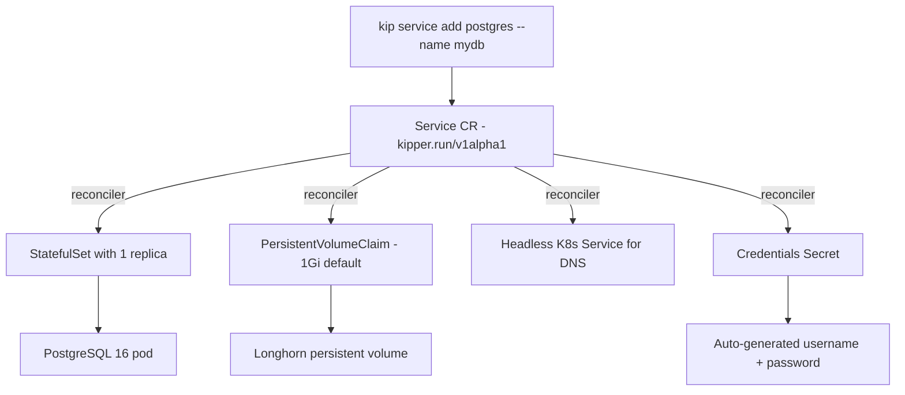

# Stateful Services

Kipper manages stateful services (databases, caches) separately from apps. Services use StatefulSets with persistent storage. They survive restarts and keep their data.

## Adding a service

```bash
kip service add postgres --name mydb
kip service add mysql --name mydb
kip service add mongodb --name mydb
kip service add redis --name cache
kip service add rabbitmq --name queue
kip service add opensearch --name search
kip service add minio --name storage
kip service add mailhog --name mailhog
```

Supported types: `postgres`, `mysql`, `mongodb`, `redis`, `rabbitmq`, `opensearch`, `minio`, `mailhog`

One name is refused: a service called `<app>-git`, where `<app>` is an app in the same project and environment that still keeps its git token under the older naming. Both would store their credentials in the same Secret, so Kipper asks you to pick another name for the service rather than let one read the other's. An app whose token is stored under the current naming does not block the name.

### Per-environment services

Each environment can have its own database with separate credentials and storage:

```bash
kip service add postgres --name db --project blog --environment test --storage 1Gi
kip service add postgres --name db --project blog --environment acc --storage 2Gi
kip service add postgres --name db --project blog --environment prod --storage 10Gi
```

Each environment has separate database storage and credentials. Size test and acceptance databases for their workloads.

### What this creates



### Options

| Flag | Default | Description |
|---|---|---|
| `--name` | Required | Service name |
| `--project` | `default` | Project name |
| `--environment` | — | Target environment (e.g. test, acc, prod) |
| `--storage` | `1Gi` | Storage size |
| `--cpu` | Request `500m` (postgres/mysql/mongodb), `100m` (others). OpenSearch has a `1000m` limit. | Sets the CPU request and limit to the same value. |
| `--memory` | `1Gi` (postgres/mysql/mongodb), `2Gi` (opensearch), `512Mi` (rabbitmq), `128Mi` (others) | Sets the memory request and limit to the same value. |
| `--tls` | `required` (postgres) | Postgres only. `required` refuses connections without TLS, `on` serves TLS and still accepts plaintext, `off` creates the service without TLS. See [Encrypted Postgres connections](#postgres-tls). |
| `--consistent-backups` | `true` (postgres) | Postgres only. Adds a `pg_dump` of every database to each backup. See [Consistent database dumps](/en/backups#consistent-database-dumps). |
| `--copies` | `1` | Copies of the data, each on a different node: `1` or `2`. Two copies need Longhorn, an admin's offer and two nodes that can hold copies. The Postgres dump volume always keeps one copy. `kip service update <name> --copies 1\|2` changes it on a running service. Once an install or upgrade has configured the `longhorn-replicated` class, new two-copy volumes have Longhorn's revision counter enabled, which costs some write throughput. Two-copy volumes created by Kipper v0.38.0 have it disabled until a copy change switches it on. Going from two copies to one stops the service until the extra copy is removed. On a cluster that offers one copy, setting the copies back to `2` needs an admin. See [Two copies of a service's data](/en/worker-nodes#two-copies-of-a-services-data). |

RabbitMQ services created with the default settings in earlier Kipper releases started with `128Mi`, which the broker can exceed during startup. Upgrading Kipper preserves their existing memory allocation. Increase it with `kip service update <name> --memory 512Mi`.

Before creating a service, `kip service add` checks that one eligible node has enough CPU and memory after existing pod requests are deducted. If capacity is insufficient, it reports the largest remaining CPU and memory capacities and their nodes. Reduce requests with `--cpu` and `--memory`, or add capacity. If no nodes qualify, it directs you to `kip status`. The check is skipped if nodes or pods cannot be read.

On a cluster with Longhorn storage, `kip service add` also checks capacity for the service's volumes: the data volume, plus a dump volume of the same size for Postgres with consistent backups. It uses Longhorn's reported maximum, reserved, scheduled and available space for each disk, together with the `storage-over-provisioning-percentage` and `storage-minimal-available-percentage` settings. Pending Longhorn volumes that fit on an eligible disk also count against that space. This includes volumes from a service created moments earlier, so consecutive commands account for those volumes even before their claims exist. Single-copy volumes are scheduled on the server, so the check covers the server's disks only. For a service with two copies, the check requires room on a distinct eligible node for each copy and counts both copies towards storage demand. With exactly two eligible nodes, one copy lands on each, so the server must hold its copy alongside the single-copy volumes pinned to it, such as the dump volume. A definite shortage stops creation. For single-copy volumes, the error names the server and reports its remaining scheduling capacity and the service's storage requirements. For two copies, it names the eligible node with the most room and reports that node's capacity. When only the second copy lacks room, it reports the other eligible node with the most room instead. When the copies required on a node or group of nodes exceed its available space, the error names the nodes, their remaining scheduling capacity and the copies that need that space. Free space with `kip service delete <name> --delete-data`, grow the server's disk, or request less storage with `--storage`. If Longhorn's state cannot be read or no node can accept new volumes, kip prints a warning and proceeds with creation. An inconclusive placement also produces a warning. Existing claims are reused and excluded from the check. Clusters on local storage skip this check. Passing the capacity checks does not guarantee scheduling because other constraints may apply.

`kip service update --consistent-backups` runs the same check for the dump volume it adds. Before writing anything, `kip apply` checks new services' volumes, new shared volumes and dump volumes for existing Postgres services whose consistent backups the manifest enables.

On a server with 8 GB RAM and 2 vCPUs, `kip install` selects the `small` profile to leave an estimated 500m CPU for a default database service. See [Preflight checks](/en/installation#preflight-checks).

## Binding to apps and functions

Bind a service to inject its connection details as environment variables. Both apps and functions accept bindings; the same prefix scheme applies.

```bash
# To an app
kip service bind db domain-service --project blog --environment test

# To a function
kip function bind domain-sync db --project blog --environment test
```

### A database of its own, when you ask for one

A binding attaches the app to the service's own database, which is what a service backing one app wants. Several apps on one instance is the case that needs more: name a database and Kipper creates it inside the service and points that binding at it.

```bash
kip service bind db domain-service --database domain_service_test --project blog --environment test
kip service bind db identity-service --database identity_service_prod --project blog --environment prod
```

A manifest binding takes the same value as `database:`. Each app then reads its own `DB_NAME` and shares everything else: the instance, the storage, and the credentials.

Kipper creates the database by running a command in the service's pod, for bindings made through the CLI, the console or a manifest. If that fails, the binding is saved, the CLI and console show the reason, and the controller tries again every minute. The app or function's `BindingDatabasesReady` status condition carries the reason as well. MongoDB creates the database on first write.

Bindings share the service’s credentials, so an app can also access sibling databases on that instance. Use separate services when apps need separate access boundaries.

PostgreSQL, MySQL, MongoDB and RabbitMQ can be divided this way. RabbitMQ calls it a vhost and takes the name in the same place, where `/` means the service's own. Redis, OpenSearch and MinIO have nothing to divide, so a binding there always points at the whole service.

### Injected environment variables

The binding injects individual connection components with a type-based prefix. The prefix depends on the service type:

**Database services** (PostgreSQL, MySQL, MongoDB), prefix `DB_`:

| Variable | Example value |
|---|---|
| `DB_HOST` | `db.blog-test.svc.cluster.local` |
| `DB_PORT` | `5432` |
| `DB_USERNAME` | `kipper` |
| `DB_PASSWORD` | `a1b2c3d4e5f6...` |
| `DB_NAME` | `domain_service_test` |
| `DB_SSLROOTCERT` | `/etc/kipper/service-ca/db/ca.crt` (PostgreSQL with TLS `on` or `required`, once its certificate is verified and its CA published. See [Encrypted Postgres connections](#postgres-tls).) |

**MinIO**, prefix `S3_`:

| Variable | Example value |
|---|---|
| `S3_ENDPOINT` | `http://storage.blog-test.svc.cluster.local:9000` |
| `S3_ACCESS_KEY` | `kipper` |
| `S3_SECRET_KEY` | `a1b2c3d4e5f6...` |

**Redis**, prefix `REDIS_`:

| Variable | Example value |
|---|---|
| `REDIS_HOST` | `cache.blog-test.svc.cluster.local` |
| `REDIS_PORT` | `6379` |

**OpenSearch**, prefix `OPENSEARCH_`:

| Variable | Example value |
|---|---|
| `OPENSEARCH_HOST` | `search.blog-test.svc.cluster.local` |
| `OPENSEARCH_PORT` | `9200` |

Redis and OpenSearch run without authentication, so their bindings carry an
address and nothing else. Redis starts with no `requirepass` and OpenSearch with
its security plugin off, which means a connection string holding a password
fails rather than being ignored: Redis answers `AUTH` with an error when no
password is set. Write `redis://${REDIS_HOST}:${REDIS_PORT}` and leave the
userinfo out.

Both are reachable by anything running in the same namespace. Treat them as
shared infrastructure for that project's environment rather than as a private
store, and keep anything sensitive in a database that does authenticate.

**RabbitMQ**, prefix `AMQP_`:

| Variable | Example value |
|---|---|
| `AMQP_HOST` | `rabbit.blog-test.svc.cluster.local` |
| `AMQP_PORT` | `5672` |
| `AMQP_USERNAME` | `kipper` |
| `AMQP_PASSWORD` | `a1b2c3d4e5f6...` |
| `AMQP_VHOST` | `orders` (the binding's vhost, or `/` if you took the default) |

Like databases for postgres/mysql, a RabbitMQ binding can either share the default vhost `/` with every other app or create its own. Pass `--database <name>` to `kip service bind` to provision a per-binding vhost. Kipper runs `rabbitmqctl add_vhost` on the running pod and grants the kipper user full access to it. Leave the flag off to share `/`.

In the console, the bind picker lists every existing vhost on the service (the default `/` is tagged) and also offers a Create new field. Picking an existing vhost reuses it; creating a new one is what most apps want.

### Where binding credentials come from

A binding that takes the service default draws on the service's own `<service>-credentials` Secret. A binding with its own database or vhost gets a Secret of its own, named for the service and the workload it belongs to: an app called `api` bound to `db` gets `db-app-api-credentials`, and a function called `api` in the same project gets `db-function-api-credentials`, so the two never read each other's database.

The controller rebuilds that Secret from the service's shared credentials on every reconcile, overriding only the database or vhost name, so rotating the service password reaches every binding without anyone re-binding. Anything you write into it by hand is overwritten on the next pass; change the service's credentials instead.

Neither Secret is read by your pods directly. The controller folds them into the workload's [published environment](/en/secrets#how-it-works-internally) along with everything else, which is what lets a connection string you composed from `${DB_PASSWORD}` stay in step with the password itself.

**Rotating a service password restarts the workloads bound to it.** Kipper publishes the updated environment and rolls the workloads so they load the new credentials. [`kip service rotate-password`](#rotating-a-service-password) does the rotation and waits for those rollouts.

**MailHog** (test SMTP server), prefix `MAIL_`:

| Variable | Example value |
|---|---|
| `MAIL_HOST` | `mailhog.blog-test.svc.cluster.local` |
| `MAIL_PORT` | `1025` |

MailHog catches outgoing mail and serves a browseable inbox. The binding injects `MAIL_HOST` and `MAIL_PORT` and nothing else, since the image has no authentication and no TLS. Your app needs `spring.mail.smtp.auth=false` (or equivalent for your framework) and a plain SMTP transport to talk to it. Open the inbox at `https://mailhog-<namespace>--<cluster>.kipper.run` (or `mailhog-<namespace>.<your-domain>` on a custom domain) (the console's Open UI button on the service detail page links there), gated by your console sign-in.

Your app constructs a connection URL from these components in whatever format your framework needs:

- **Node.js / Python / Ruby / Go:** `postgres://${DB_USERNAME}:${DB_PASSWORD}@${DB_HOST}:${DB_PORT}/${DB_NAME}`
- **Java / Spring Boot (JDBC):** `jdbc:postgresql://${DB_HOST}:${DB_PORT}/${DB_NAME}`
- **S3 endpoint (MinIO):** `${S3_ENDPOINT}`

### Unbinding

Remove a binding from the console (env tab → click X on the service) or the CLI:

```bash
kip service unbind db domain-service --project blog --environment test
```

Deleting a service automatically unbinds it from all apps. The per-app databases are not dropped. They remain in the PostgreSQL instance for manual cleanup if needed.

The app restarts automatically when a binding is added or removed.

## Connection details

After creating a service, the connection details are displayed with the password masked:

```
  Host:     mydb.default.svc.cluster.local
  Port:     5432
  Username: kipper
  Password: ********
  Database: app
```

Retrieve the connection details later with `kip service info`. Add `--show-secrets` to reveal the password, including in the connection URL:

```bash
kip service info mydb
kip service info mydb --show-secrets
```

kip masks passwords and S3 secret keys by default because terminal logs and CI output can retain them, and shared screens can expose them. `kip service bind` supplies credentials to apps through environment variables, so you can connect apps without copying passwords by hand.

The output also shows `Pod node`, where the service is scheduled (or `not scheduled` with the scheduler's reason), and `Data node`, the nodes that hold a healthy copy of its data, each counted once. For Longhorn volumes, a copy is healthy when its data is current and its node is ready and not fenced. After the count, kip lists any nodes that hold a current copy but are not Ready or are fenced, because those copies still exist. If kip cannot read a node's details, it names the node and marks its copy as not checked. For local-path volumes, the data node comes from the volume's node affinity without a health check. Kipper configures new service volumes to keep one copy on the server. Existing copies may still be on workers. `kip upgrade` and `kip status` report them.

The hostname (`mydb.default.svc.cluster.local`) is an internal Kubernetes DNS name. Apps in the same namespace can connect directly; [network policies](/en/security#network-isolation-between-namespaces) restrict access from other namespaces.

## Encrypted Postgres connections {#postgres-tls}

New Postgres services created through the CLI or console require TLS by default: they refuse any network connection without it. Each one gets a certificate from the cluster's own service certificate authority, `kipper-service-ca`, which `kip install` and a full `kip upgrade` (without `--skip-system`) provision alongside cert-manager. The certificate names the service by every form of its internal DNS name (`mydb`, `mydb.default`, `mydb.default.svc` and `mydb.default.svc.cluster.local`), is valid for a year, and is renewed 30 days before it expires.

A service has one of three TLS modes:

| Mode | What Postgres does |
|---|---|
| `required` | Serves TLS and refuses network connections without it. The default for new services. |
| `on` | Serves TLS and still accepts connections without it. The client decides. |
| `off` | Serves no TLS. |

```bash
kip service update mydb --tls on         # serve TLS, still accept plaintext
kip service update mydb --tls required   # refuse plaintext from now on
kip service update mydb --tls off
kip service add postgres --name mydb --tls on   # create one that still accepts plaintext
```

Move an existing service to `required` in three steps to avoid unexpectedly disconnecting apps. Turn TLS `on` and wait until `kip service info mydb` shows that TLS is being served. Set `sslmode=require` or `verify-full` in every app that connects, then restart the apps so their pooled connections reconnect with TLS. Finally run `kip service update mydb --tls required`. Before switching, kip checks for clients currently connected without TLS. If it finds any, it lists them and refuses the change. `--force` allows the change despite those connections. The check covers only currently connected clients, so check scheduled jobs, stopped apps and other disconnected clients yourself.

In `kipper.yaml`, the `tls` field of a Postgres service accepts the same three modes. A new service declared without it defaults to `required`, like one created with `kip service add`. For an existing service, omitting the field preserves its configured mode, so omission alone leaves the database’s TLS mode unchanged. To change the mode, set the field. `kip export` writes the field for services that have it.

Postgres restarts once when it switches between any two modes, and again whenever its certificate is renewed, which is about once a year. In mode `on`, a new service waits up to a minute for its first certificate to avoid starting twice. If issuance takes longer, a service in mode `on` starts with plaintext and restarts when the certificate arrives, so a cluster without cert-manager keeps serving it with plaintext. In mode `required`, a new service waits for a usable certificate before starting. If a running service's certificate is missing or unusable, it keeps its current pod and defers other changes, such as a resize, to preserve TLS. `kip service info mydb` shows the mode once Postgres has restarted with the certificate, and explains any pending issuance or rollout. Turning TLS off or deleting the service removes the certificate and its private key. Backups include the issued Secret and its private key along with the rest of the service, so a restored database or one checked with `kip backup drill` starts with TLS immediately. After a restore, Kipper asks cert-manager to issue a new key pair for the service. Postgres restarts once more to use it, replacing the key retained in the backup. The copy of the key in the pod's memory volume is left out of backups.

Most Postgres clients try TLS first and connect to a `required` service without changes: libpq and everything built on it (psql, psycopg), pgx, and pgjdbc 42.2.5 or later all default to `sslmode=prefer`. node-postgres does not use TLS unless told to, so set `ssl` in its options. Set `sslmode=require` in an app's connection string (`?sslmode=require` on a JDBC or libpq URL) to make sure it never falls back to plaintext against a service in mode `on`. An app that connects without TLS to a `required` service gets an error saying that pg_hba.conf has no entry for its host with encryption off. Postgres-triggered functions prefer TLS when connecting to the service. For a service in mode `on` or `required`, Kipper's console database view verifies the server's certificate against the service CA and the service's DNS name. It can connect once the certificate is issued and Postgres serves it. Without a configured CA, `require` encrypts the connection without verifying the server's certificate.

Once the certificate is verified and its CA published, Kipper mounts the service CA into every app and function bound to the service at `/etc/kipper/service-ca/<service>/ca.crt`, and the binding adds `<prefix>SSLROOTCERT` with that path, for example `DB_SSLROOTCERT`. Only the CA is mounted. The server's private key stays with Postgres. Kipper publishes the CA only after checking that the issued certificate chains to it, covers the service's DNS name, is currently valid and permits server authentication.

To encrypt every connection and verify the database server's identity, set `sslmode=verify-full` and point the client at the CA:

| Client | Setting |
|---|---|
| JDBC (pgjdbc) | `jdbc:postgresql://${DB_HOST}:${DB_PORT}/${DB_NAME}?sslmode=verify-full&sslrootcert=${DB_SSLROOTCERT}` |
| libpq, psql, psycopg | `PGSSLMODE=verify-full` and `PGSSLROOTCERT=$DB_SSLROOTCERT`, or `sslmode=verify-full&sslrootcert=...` in the URL with the path from `DB_SSLROOTCERT` |
| Go (pgx) | `postgres://...?sslmode=verify-full&sslrootcert=...` with the path from `DB_SSLROOTCERT` |
| Node.js (pg) | `ssl: { ca: fs.readFileSync(process.env.DB_SSLROOTCERT), rejectUnauthorized: true }` |

Adding or removing the CA triggers one rollout of every app and function bound to the service, in addition to restarting Postgres. `sslmode=require` lets clients without a CA encrypt connections without verifying the server. With libpq, `require` also verifies the certificate chain if a root CA file is available. Use `verify-full` explicitly to verify both the chain and hostname. Apps opt in to verification through their connection settings. Turning TLS off on a service whose apps use `verify-full` makes their connections fail until you change those settings back. The CA stays the same across certificate renewals. When the CA changes, for example after rebuilding a cluster from backups, bound apps and functions roll out again to load the new CA.

To see which connections use TLS:

```bash
kip exec mydb -- psql -U kipper app -c "SELECT a.usename, a.client_addr, s.ssl, s.version FROM pg_stat_ssl s JOIN pg_stat_activity a USING (pid) WHERE a.client_addr IS NOT NULL"
```

To look at the certificate itself, open a tunnel and ask for it:

```bash
kip tunnel mydb &
openssl s_client -starttls postgres -connect localhost:5432 -showcerts </dev/null
```

The certificate names the service, not `localhost`, so desktop clients connecting through `kip tunnel` need `sslmode=require` rather than `verify-full`.

Postgres continues to trust connections over its local socket inside the pod, which is how `kip exec mydb -- psql` logs in without a password. The service CA's private key is a Secret in the `cert-manager` namespace, so anyone who can read Secrets there can issue certificates signed by the cluster's service CA. Backups exclude that key, so a cluster rebuilt from backups gets a new service CA. Each restored service gets a new key pair and a certificate signed by the new CA shortly after the restore.

## MinIO (S3-compatible object storage)

MinIO provides S3-compatible object storage for file uploads, media, documents, and other binary data.

```bash
kip service add minio --name storage --project blog --environment test
```

```
  Connection details:
    Endpoint:   http://storage.blog-test.svc.cluster.local:9000
    Access Key: kipper
    Secret Key: a1b2c3d4e5f6...
```

Bind MinIO to your app to inject credentials automatically:

```bash
kip service bind storage api --project blog --environment test
```

This injects `S3_ENDPOINT`, `S3_ACCESS_KEY`, and `S3_SECRET_KEY` into the app. Use them with any S3-compatible SDK (AWS SDK, MinIO SDK, boto3). See the [Storage](/en/storage) page for mc CLI examples and SDK code samples.

### File explorer

MinIO services include a built-in file explorer in the web console. Navigate to **Storage** in the sidebar to browse buckets, upload and download files, delete objects, and generate share links (presigned URLs). See the [Storage](/en/storage) page for full details.

## Browser-based database console

Postgres and MySQL services have a built-in client in the web console: SQL editor with schema-aware autocomplete, table browser with inline row editing, visual table and index designer, AI assistant that knows your schema, and per-user query history. No desktop tool needed.

Click the code icon on a Postgres or MySQL service row in the Services list (or open the side panel and click the same icon next to AI Diagnose) to open it. See the [Database Console](/en/database-console) page for the full tour.

For other database types (MongoDB, Redis, OpenSearch, RabbitMQ), use a desktop client through `kip tunnel` as described below.

## Service web interfaces

<span id="browseable-service-uis"></span>
<span id="how-the-session-behaves"></span>
<span id="revoking-service-ui-sessions"></span>
<span id="sharing-a-ui-without-a-login"></span>
<span id="if-a-link-leaks"></span>
<span id="ingress-controller-selector"></span>

See [Service UIs & Sharing](/en/service-uis) to open web interfaces such as MailHog and RabbitMQ, manage sessions, or share a temporary access link.

## Connecting from your machine

Services run inside the cluster and are not exposed to the internet. To connect with a desktop database client (DBeaver, TablePlus, pgAdmin, RedisInsight, or any other tool), use `kip tunnel` to open a secure connection from your machine to the service:

```bash
kip tunnel mydb
```

```
  ✔  Tunnel open: localhost:5432 → mydb (postgres)
  Press Ctrl+C to close
```

Open your database client and connect to `localhost:5432` with the credentials from `kip service info mydb --show-secrets`.

If the default port is already in use on your machine, pick a different one:

```bash
kip tunnel mydb --local-port 15432
```

For services in a specific environment:

```bash
kip tunnel db --project blog --environment staging
```

See [Team Access](/en/team-access) for the full tunnel documentation, including Redis examples and troubleshooting.

## Listing services

```bash
kip service list
```

```
  NAME       TYPE         STATUS         READY      STORAGE
  mydb       postgres     running        1/1        5Gi
  cache      redis        running        1/1        1Gi
```

Services also appear in the web console under the **Services** sidebar item, where you can view connection details with a masked URL and copy-to-clipboard.

A service whose container Kubernetes has given up restarting reads
`crash-looping`, with the detail below the table:

```
  NAME       TYPE         STATUS         READY      STORAGE
  db         postgres     crash-looping  0/1        20Gi

  !   db (CrashLoopBackOff)
      container "postgres" has restarted 996 times and is not staying up
      (last exit code 1). Check its logs. If the cause is storage rather than
      its image or configuration, 'kip service restart db' recreates the pod,
      which is the one thing a container restart cannot do
```

A crash loop is usually the image or the configuration, and a recreated pod
comes back with both, so the listing says to look before it says to restart.
Where recreation genuinely is the remedy is a mount that went read-only
underneath the pod, and that gets [its own
alert](/en/alerts#read-only-volumes).

When a pod cannot be scheduled, the service listing includes the scheduler's
reason:

```
  !   db (FailedScheduling)
      the pod cannot be scheduled: 0/1 nodes are available: 1 Insufficient cpu.
      For insufficient CPU or memory, reduce requests with
      'kip service update db --cpu <cpu> --memory <memory>' or add cluster capacity.
```

`kip service info` shows the same reason after `Pod node: not scheduled`.

When a pending pod has no assigned node and its revision differs from the
StatefulSet's update revision, Kipper deletes it so the StatefulSet can create
one from the updated template. This lets changes from
`kip service update <name> --cpu <cpu>` or `kip service restart <name>` reach
a pod whose readiness would otherwise block the update.

An app bound to it keeps its own status, because the app really is running. Its
broken dependency is named under `kip app list`:

```
  !   api depends on db, which is crash-looping
      kip service list  shows why, and what to try
```

## Restarting a service

```bash
kip service restart <name>
```

This recreates the service's pod, which is what a container restart cannot do.
The volume is reattached rather than recreated, so the data is untouched.

Reach for it when a service is crash-looping on something that belongs to the
pod rather than to the container. The clearest case is a volume that remounted
read-only: the mount belongs to the pod, so however many times the container
dies it comes back to the same read-only filesystem. See [Recovering a read-only
volume](/en/alerts#recovering-a-read-only-volume).

`kip service restart` finds the service by name across the cluster. Name the
project when two of them run a service under the same name:

```bash
kip service restart db --project shop --environment prod
```

## Rotating a service password

```bash
kip service rotate-password db
```

This gives a Postgres, MySQL, MongoDB, RabbitMQ or MinIO service a new random password. kip changes the password inside the engine, stores it in the service's credentials Secret, and recreates the service's pod so every session opened with the old password ends. It then waits for the apps and functions bound to the service to roll out the new password and reports each completed update. Cron functions use the new password on their next scheduled run. Pass `--yes` to skip the confirmation, and `--project` and `--environment` when two projects run a service under the same name.

The old password stops working as soon as the engine has the new one, so bound apps may fail to connect to the service until they restart. A few things keep the old password because kip cannot reach them: runs of jobs and cron functions that had already started, values pasted by hand into an environment variable or an external client, and backups or dumps taken before the rotation. Restoring one of those backups brings the old password back.

MinIO reads its root secret key only when it starts, so for MinIO the pod restart is the moment the new key takes effect.

kip changes a RabbitMQ password through the management plugin, which Kipper's default RabbitMQ image includes. The service image must include the management plugin for this command to work.

A cluster admin must run this command because it checks the cluster's backups and pauses resource tuning on the service. Project roles lack both permissions.

kip refuses to start while an unfinished backup may include the project, because that backup could save the volume under one password and the credentials under the other. Rotation can proceed if kip can confirm that the backup excludes the project's namespace. Run the command again once the backup has finished. A backup that starts during the few seconds of the change itself can still catch that mix, so take a fresh backup after a rotation if you rely on backups for this service.

If the rotation is interrupted before the password is stored, for example by Ctrl-C or a lost connection, run the same command again to resume it. kip keeps the new password in a `<service>-password-rotation` Secret until it is committed to the credentials Secret. The next run resumes any rotation whose record remains. After the password is stored, follow the restart or status-check instructions in the output. `kip service credentials` reports any remaining rotation record.

## Checking that a service owns its credentials

Each service has a credentials Secret, and Kipper only injects those values into an app when the Secret belongs to that service. Ownership is the whole check, so a Secret that lost it leaves the service running normally while every app bound to it is refused the credentials it asked for.

That is rare, and worth checking in two situations: after restoring a backup, and before upgrading a cluster.

```bash
kip service credentials --project blog --environment test
```

```
  SERVICE                  SECRET                             STATE
  db                       db-credentials                     owned
  cache                    cache-credentials                  unowned
  -                        db-app-reports-credentials            unowned binding secret

  Run again with --repair to fix these.
```

`--repair` gives an unowned Secret back to its service and removes per-binding Secrets nothing owns, which the apps that need them render again for themselves:

```bash
kip service credentials --project blog --environment test --repair
```

```
  ✔  cache-credentials now belongs to service cache
  ✔  db-app-reports-credentials removed; nothing reads it and its workload renders a replacement it owns
```

A per-binding Secret that a running app still reads is left where it is and reported, because removing one an app points at would let its next restart come up with no credentials at all. Run the check again after the app has restarted and it will be cleared then.

Repair never touches the credentials themselves, so a database keeps the password it already has and the apps bound to it carry on with the values they are already using. A Secret that belongs to something else is reported rather than taken.

## Deleting a service

Deleting a service removes the service and the workload behind it. The volume it kept its data on stays where it is unless you ask for that to go too:

```bash
# The service goes, the volume stays
kip service delete mydb

# The service goes, and the volume with it
kip service delete mydb --delete-data
```

::: danger
`--delete-data` is irreversible. The persistent volume and all data are permanently deleted. There is no undo.
:::

What `--delete-data` removes is the volume Kipper created for the service. One that was renamed, or whose labels were changed by hand, is no longer recognizable as that service's and stays where it is, and the command says when it found nothing to remove. Recognizable means the name a StatefulSet gives a claim, `data-<service>-0`, carrying that service's `app` label. When the service itself has already gone that is the only evidence left, so name a service you no longer have carefully.

A volume left behind is what a service of the same name lands on later, and Kipper blocks that service with `DataWithoutCredentials`: there is data on the volume and no password recorded that opens it. `kip service list` names any service in that state under the table. Run the delete again with `--delete-data` once the data is genuinely finished with.

A delete that stops on a name collision, because the workload under that name turned out to belong to something else, keeps the service until the collision is cleared. The service says which object it means. If the leftover object is the one you want to keep, remove the `kipper.run/delete-data` annotation from the Service with `kubectl` and the service finishes leaving with its volume where it is.

Some services have no record for Kipper to delete: ones created before Kipper kept those records, and ones whose record has already gone, leaving the volume behind. Deleting either needs `--delete-data`, and the volume goes with it. Without the flag the command says so and deletes nothing.

Deleting from the web console destroys the data, which is what its confirmation asks you to type the service name for. The service stays in the list as `deleting` until the volume has actually gone, because the workload has to stop first, and both `kip service list` and the console say so. A delete that cannot finish, because the workload turned out to belong to something else or a volume will not go, stays there and says which step stopped it. Deleting the Service with `kubectl` keeps the volume, the same as `kip service delete` without the flag; annotate it with `kipper.run/delete-data=true` first to have the volume go too.

## Importing and exporting data

`kip service import` loads a database dump into a running service, and `kip service export` pulls one out. The dump streams through the Kubernetes API straight into the engine's own restore tool inside the service pod, so nothing is written to the server's disk and no extra port needs to be open. Supported engines: MongoDB, PostgreSQL, and MySQL.

```bash
kip service import mongodb --file backup.archive.gz --project acme --environment test
```

```
  Importing backup.archive.gz (48.2 MiB) into acme-test/mongodb...

  ... mongorestore progress ...

  ✔  Import complete
```

Accepted formats per engine:

| Engine | Import accepts | Export produces |
|---|---|---|
| mongodb | `mongodump --archive` (plain or gzipped) | gzipped archive (`.archive.gz`) |
| postgres | `pg_dump -F c` custom dumps or plain SQL (plain or gzipped) | custom-format dump (`.dump`) |
| mysql | SQL scripts (plain or gzipped) | gzipped SQL (`.sql.gz`) |

The format is detected from the file's content. Postgres and MySQL default to the service's own database; pass `--database` to target a different one. A MongoDB archive restores the databases it contains; add `--database` and `--source-database` together to rename on restore:

```bash
kip service import mongodb --file prod-backup.archive.gz --database acme --source-database prod
```

`--drop` replaces existing data instead of failing on it. For postgres it needs a custom-format dump (`pg_dump -F c`); a plain SQL script manages its own DROP statements.

Exports mirror the same shape:

```bash
kip service export mydb --file nightly.dump --database app
```

```
  Exporting blog-prod/mydb to nightly.dump...

  ✔  Exported nightly.dump (12.4 MiB)
  Restore with: kip service import mydb --file nightly.dump
```

While an import or export runs, the resource tuner is paused for that service. A saturation-triggered resource change would restart the database mid-restore. The pause is a short lease the CLI keeps renewing for as long as the transfer runs, so if the CLI dies the tuner resumes by itself within 15 minutes.

## Copying data between environments

When you copy an environment via the wizard, the new env's databases come up empty. To bring data over, open a service in the new env and switch to the **Migrate data** tab in the side panel. The tab lists every same-named, same-type service in other namespaces (e.g. the same `backend` postgres in your `test` env). Click **Copy data here** next to the source you want, type the service name to confirm, and the migration starts as a Kubernetes Job in the target namespace.

What it does, in postgres terms:

```
PGPASSWORD=$SOURCE pg_dump --clean --if-exists ... | PGPASSWORD=$TARGET psql --set ON_ERROR_STOP=1 ...
```

The `--clean --if-exists` makes re-runs safe. Every object is dropped before being recreated. The `ON_ERROR_STOP` setting fails the job loudly on any restore error rather than leaving you with a half-restored database.

A few things worth knowing:

- **The target database is wiped.** Tables, sequences, views, everything. The wizard's confirm modal asks you to type the service name on purpose.
- **Temporary source credentials.** The job mounts a temporary copy of the source service's credentials secret in the target namespace. The mirror is owned by the job and gets garbage-collected when the job is cleaned up (one hour after completion).
- **No retries.** If the dump or restore fails, the job stops there. Re-run it after fixing the underlying issue. Re-runs overwrite cleanly.
- **Supported engine:** PostgreSQL.

The status panel polls every couple of seconds while a migration is running and tails the last 50 lines of pod logs so you can see `pg_dump` progress as it happens.

## Resource limits

Open a service in the web console and select the **Resources** tab to adjust its CPU and memory size.

Resource limits control how much CPU and memory the service pod is allowed to consume. Databases under heavy query load or caches handling high throughput may need higher limits than the defaults.

The console sliders and `kip service update <service> --memory <size> --cpu <size>` set fixed sizes, with request equal to limit. To define a range, set a request below its limit in `kipper.yaml` or the Service custom resource. Kipper then tunes the request within that range and keeps the limit fixed. See [Your own CPU and memory values](/en/resource-management#your-own-values).

::: warning
Changing resource limits on a service triggers a pod restart. For databases (PostgreSQL, MySQL, MongoDB), this means a brief period of downtime while the pod restarts with the new limits. Plan resource changes during a maintenance window or low-traffic period.
:::

## How services differ from apps

| | Apps | Services |
|---|---|---|
| Kubernetes resource | Deployment | StatefulSet |
| Storage | Optional volume mounts | PersistentVolumeClaim |
| Restart | Rolling update | Pod recreated, volume reattached |
| Delete | Immediate | Volume kept unless `--delete-data` |
| Scaling | `kip app scale` | Single replica |
| External access | Via Ingress (public URL) | Internal only (cluster DNS) |
