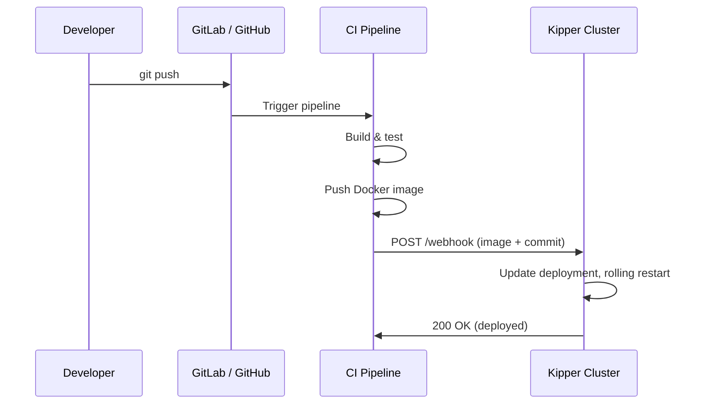

# Webhooks & CI/CD Integration

Kipper integrates with your existing CI/CD pipeline. Your CI system (GitLab CI, GitHub Actions) builds and tests your code. Kipper handles the deployment.

## How it works



## Setting up webhooks

### 1. Enable the webhook

```bash
kip app webhook enable backend --project blog --environment test
```

```
  ✔  Webhook enabled for backend

  Webhook URL:    https://console--203-0-113-12.kipper.run/api/v1/webhook/blog-test/backend
  Secret token:   a3f8b2c4d5e6f7890123456789abcdef...

  GitLab CI snippet (.gitlab-ci.yml):

    deploy:
      stage: deploy
      script:
        - |
          curl -s -X POST https://console--<cluster>.kipper.run/api/v1/webhook/blog-test/backend \
            -H "X-Kipper-Token: $KIPPER_WEBHOOK_TOKEN" \
            -H "Content-Type: application/json" \
            -d '{"image": "'$CI_REGISTRY_IMAGE:$CI_COMMIT_SHORT_SHA'", "commit": "'$CI_COMMIT_SHORT_SHA'"}'
```

### 2. Add the token to your CI settings

- **GitLab**: Settings → CI/CD → Variables → Add `KIPPER_WEBHOOK_TOKEN`
- **GitHub**: Settings → Secrets and variables → Actions → Add `KIPPER_WEBHOOK_TOKEN`

### 3. Add the deploy step to your pipeline

**GitLab CI (.gitlab-ci.yml):**

```yaml
deploy:
  stage: deploy
  script:
    - |
      curl -s -X POST $KIPPER_WEBHOOK_URL \
        -H "X-Kipper-Token: $KIPPER_WEBHOOK_TOKEN" \
        -H "Content-Type: application/json" \
        -d '{"image": "'$CI_REGISTRY_IMAGE:$CI_COMMIT_SHORT_SHA'", "commit": "'$CI_COMMIT_SHORT_SHA'"}'
  only:
    - main
```

**GitHub Actions:**

```yaml
- name: Deploy to Kipper
  run: |
    curl -s -X POST ${{ secrets.KIPPER_WEBHOOK_URL }} \
      -H "X-Kipper-Token: ${{ secrets.KIPPER_WEBHOOK_TOKEN }}" \
      -H "Content-Type: application/json" \
      -d '{"image": "ghcr.io/${{ github.repository }}:${{ github.sha }}", "commit": "${{ github.sha }}"}'
```

## Webhooks with `--git` apps

With `--image` apps the webhook payload usually carries `"image": "..."` so Kipper just rolls out the new tag. With `--git` apps, POST `"commit": "..."` from your CI to fire a rebuild from the configured git source, or let Kipper notice the change itself.

For a Git-built app, send a commit to trigger a build. To deploy images built by your pipeline, detach the Git source first. Sending an `image` while Git is configured returns **409 Conflict**.

```bash
kip app git remove checkout --project shop --environment production
```

```
  ✔  checkout no longer builds from git
     It keeps running the image it has. Deploy a new one with
     'kip app update checkout --image <image>' or from your pipeline.
```

The Git source card in the console has a Remove button that does the same thing.

Trigger the webhook from CI with the request format below. A Git provider's push webhook (GitHub or GitLab pointing directly at Kipper) sends a provider-specific payload without the `commit` field required for Git-built apps. After authentication succeeds, Kipper rejects that payload with HTTP 400.

## Webhook request format

```
POST /api/v1/webhook/{namespace}/{app}
Header: X-Kipper-Token: <token>
Content-Type: application/json

{
  "image": "registry.git.example.com/api:abc123f",
  "commit": "abc123f"
}
```

| Field | Required | Description |
|---|---|---|
| `image` | For image-based apps | Full image reference including tag. Omit for Git-built apps |
| `commit` | For Git-built apps | Git commit SHA to build. For image-based apps it is optional and shown in deploy history |

## Deploy history

Every deployment, whether triggered by webhook, manual update, promotion, or rollback, is recorded.

```bash
kip app history backend --project blog --environment test
```

```
  #     IMAGE                                              COMMIT     TRIGGER      WHEN
  3     registry.git.example.com/api:abc123f                   abc123f    webhook      2 min ago (current)
  2     registry.git.example.com/api:def456a                   def456a    webhook      1 hour ago
  1     registry.git.example.com/api:ghi789b                   ghi789b    manual       3 hours ago
```

Deploy history is also visible in the web console under the **Deploys** tab in the app detail panel.

## Rollback

If a deployment breaks something, rollback to a previous version:

```bash
# Rollback to the previous version
kip app rollback backend --project blog --environment test

# Rollback to a specific revision
kip app rollback backend --revision 1 --project blog --environment test
```

```
  ✔  Rolled back backend to revision #2 (registry.git.example.com/api:def456a)
```

Rollback is also available from the web console. Each entry in the deploy history has a **Rollback** button.

## Managing webhooks

```bash
# Check webhook status and token
kip app webhook status backend --project blog --environment test

# Regenerate the token (invalidates the old one)
kip app webhook enable backend --project blog --environment test

# Disable webhooks
kip app webhook disable backend --project blog --environment test
```

## Security

- Each app has its own unique webhook token
- Tokens are stored as Kubernetes Secrets in the app's namespace
- The webhook endpoint verifies the token before making any changes
- A request in Kipper's format can authenticate with a GitHub-style HMAC signature (`X-Hub-Signature-256`) if a nonempty `X-Kipper-Token` or `X-Gitlab-Token` header fails token verification. A signature alone returns HTTP 401
- Webhook URLs are scoped to a specific namespace and app, so a token for one app cannot deploy another
